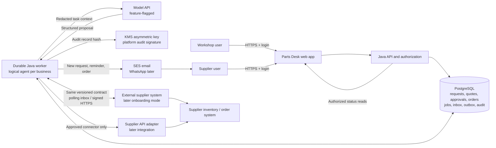
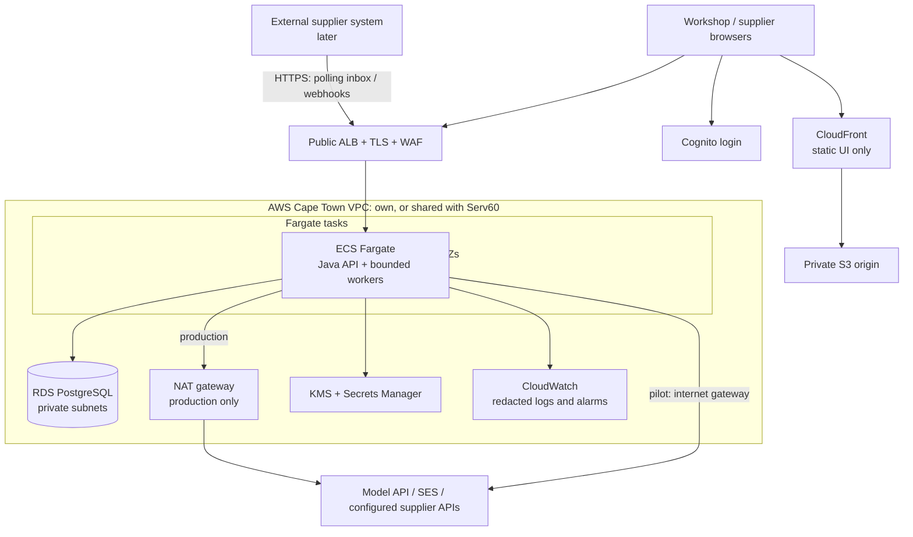

# Parts Desk — high-level design

**Status:** proposed implementation architecture; this document does not deploy or implement the product.

**Date:** 14 October 2026; pricing researched 13 October 2026. **Revision 2**, 14 October 2026, after architecture review.

**Initial market assumption:** independent workshops and their approved parts suppliers in one South African town.

**Decision:** Java/Spring Boot application, PostgreSQL-owned workflows, a transport-neutral partner message contract carried by the application's own inbox and outbox tables during the pilot, and AWS Cape Town hosting. Start with a permissioned supplier portal pilot with email notifications; connect external supplier systems through the same contract over signed HTTPS; adopt relay or agent-protocol federation only when a gated need appears (Appendix A).

### What changed in revision 2

The architecture review of 14 October 2026 found that the first draft spent roughly half its design, cost and schedule on a Nostr transport that, with every pilot participant hosted by Parts Desk, carried messages from our own worker through our own relay back to our own worker. It also found that the pilot's dominant risk, supplier response, had no notification design. This revision:

- replaces the pilot transport with the inbox/outbox tables behind the unchanged `BusinessMessageTransport` seam, and moves Nostr, the signer service and relay hosting to Appendix A behind explicit gates;
- adds a supplier notification channel (section 4) and a manual validation step before build (section 12);
- removes the signer, relay and pilot NAT gateway from the hosting baseline and adds a shared-platform option with Serv60 (section 9);
- states the effort estimate with and without federation transport (section 11);
- records the row-level-security dispatcher-role decision as an LLD requirement (section 5) and makes model assistance a flagged phase rather than a prerequisite (section 6).

The working budgets fall from $350 to $225 per month for the pilot and from $1,150 to $925 for small commercial production, on the same verified rates.

## 1. Product and architectural decision

Parts Desk reduces the staff time spent asking suppliers for a known part, checking stock and delivery, comparing offers, and chasing order acknowledgment. A workshop submits a request once, receives comparable offers, approves a specific offer, and follows the resulting order.

The first product is a purchasing assistant for **exact manufacturer/brand and part-number combinations**. Vehicle diagnosis and inferred fitment are outside the initial scope. A part number alone is not globally unique; brand, identifier namespace, unit of measure, pack size and quantity are part of the request. Substitutions require explicit review.

The application owns identity, permissions, deadlines, retries, approvals, purchase-order state and audit. AI helps interpret text, identify missing details and explain comparisons, behind a feature flag. A versioned, transport-neutral message contract carries messages between business agents; in the pilot both agents are hosted, so the transport is the application's own inbox and outbox tables. Supplier systems or authorized supplier staff remain the authority for their stock and fulfillment commitments.

This is a **separate product and deployable application**. Serv60 can become a customer or integrate through an authenticated procurement API. Its existing booking, inventory, payments and website are not replaced. A Parts Desk supplier acknowledgment must not automatically mark a Serv60 service kit as received or ready; physical receipt and fitment checks remain in Serv60. See the [existing Serv60 HLD](HLD-serv60-platform.md).

### What the first pilot includes

- Three workshops, five approved suppliers, one town; first evaluate 50 real requests, the first of them manually (section 12, phase 0).
- Workshop request and comparison screens; supplier inbox and quote form; approval and order timeline; operator administration.
- Email notifications to supplier staff for new requests, reminders and orders, each with a link into the quote or order form; WhatsApp Business evaluated as the second channel once response rates are measured.
- One currency per request, initially ZAR. Show unit/pack quantity, tax inclusion, delivery charge, total and offer expiry explicitly.
- Staff-confirmed stock and delivery via a responsive supplier portal. A verified inventory API connector can replace manual confirmation later.
- Human approval for each purchase order. Payment continues through the businesses' existing arrangements.
- Authenticated users, organization-scoped data, durable retries and a documented manual recovery path.

Automatic payments, open public supplier registration, a general agent marketplace, automated fitment, arbitrary web browsing, autonomous price negotiation, customer vehicle records, per-business signing keys and relay-based federation are deferred. Supplier onboarding and reliable replies are the commercial risks to validate first.

### Why the transport is a seam and not a protocol

The intended network connects independently owned businesses that may eventually run different software. What makes that possible is a published message contract and a verified partner registry, not a particular wire. In the pilot every participant is hosted by Parts Desk: sender, recipient, store and operator are one party, so a relay would carry messages from our own worker, through a server we run, back to our own worker, to be written into the same database. The first draft's own analysis showed that a relay provides no delivery guarantees, so the application had to rebuild them; that its encryption hides nothing from the operator who holds every key; and that supplier systems are servers with stable connectivity rather than intermittently connected clients that need a mailbox.

`BusinessMessageTransport` therefore has several implementations, chosen by what a peer can run (section 7). The pilot uses the in-database implementation. The first external supplier system uses a polling inbox API or signed HTTPS webhooks. Relay-based or agent-protocol federation is designed in Appendix A and built only when its gate is met: a second platform operator, an industry body, or suppliers demanding a portable identity.

## 2. Java, Go or Rust?

**Choose Java for the application and durable workflow runtime.** The current Serv60 backend build uses Java 25, Spring Boot 4.1.1, Spring Modulith 2.1.1, JDBC and Flyway; `platform/backend/pom.xml` pins these versions. This is a verified repository baseline, not a claim that those exact patch versions should remain frozen. Recheck vendor support and security patches when implementation starts.

| Option | Strength for Parts Desk | Main tradeoff | Decision |
| --- | --- | --- | --- |
| Java + Spring Boot | Established transaction, authorization, validation, observability and testing tools; matches the existing engineering stack | Higher baseline memory than a small Go/Rust service | Recommended for the business application, scheduler and connectors |
| Go | Straightforward binaries and concurrent network services; good option for an experienced Go team | Introduces a different application stack and duplicates existing domain/security conventions | Credible greenfield alternative; no demonstrated need to switch here |
| Rust | Strong memory-safety model and useful cryptography ecosystem | Higher implementation cost for frequently changing procurement rules; another operational skill set | Optional narrow component only if a federation transport needs native cryptography that Java cannot qualify (Appendix A) |

Supplier response time, model latency and external-system reliability will dominate this workload. No measured requirement justifies rewriting the business application for lower-level performance. Separate deployment roles do not require separate languages. The question is where to spend the novelty budget, and the answer is nowhere near the language.

### Java choices that matter here

- **Virtual threads** (`spring.threads.virtual.enabled=true`) for blocking model, HTTP and connector calls. No reactive stack; a thirty-second model call no longer holds a platform thread.
- **Spring Modulith's event publication registry**, JDBC-backed, as the transactional in-process outbox with resubmission of incomplete publications. It is not a timer, so reminders and deadlines use the job table.
- **JDBC rather than JPA**, as Serv60 does. The tenant-scope `SET LOCAL`, the lease query and the fencing update stay explicit.
- **Container-aware JVM settings** and Spring AOT or AppCDS for start-up. No GraalVM native image for one always-on task; it would save a few dollars a month and add a build problem.
- **Graviton/ARM** as the first measured optimization once the regional rate is verified. Nothing in the pilot stack depends on x86.

### Initial stack

| Area | Choice |
| --- | --- |
| Customer and supplier UI | React + TypeScript responsive web app, static build on S3/CloudFront; no native app required |
| API and workflow worker | Java 25 baseline, supported Spring Boot patch, Spring Security OIDC/JWT, Bean Validation |
| Domain structure | Modular monolith; module API boundaries checked with Spring Modulith/ArchUnit |
| Persistence | RDS PostgreSQL, JDBC, Flyway; explicit transactions and optimistic versions |
| Background work | PostgreSQL job table with bounded leased work and durable timers; Spring Modulith event publication registry for transactional in-process events |
| AI | Provider-neutral `LanguageModel` interface behind a feature flag; small structured-output model; deterministic rules remain in Java |
| Partner messaging | `BusinessMessageTransport` with an in-database implementation for the pilot; polling inbox and signed HTTPS webhooks for the first external system; relay or A2A adapters only at federation stage (Appendix A) |
| Audit evidence | Platform-signed audit records using one KMS asymmetric key; per-business keys deferred to federation |
| Supplier notifications | Amazon SES email with links into the portal; WhatsApp Business API evaluated after the pilot |
| Human login | Amazon Cognito user pool; membership/roles maintained in the application; MFA for approvers/admins |
| Files | Private S3 objects with authorized short-lived access; no attachments in the first release |
| Infrastructure and delivery | AWS CDK in TypeScript, container images in ECR, CI using OIDC instead of long-lived AWS credentials; shares Serv60's VPC, ALB, NAT, WAF and RDS instance when that platform exists first |
| Visibility | Structured logs, Micrometer/OpenTelemetry metrics and traces, CloudWatch dashboards and alarms |

No Kubernetes, Kafka, vector database, external agent framework, relay host or signer service is needed for this pilot. Add SQS when measured queue load or workload isolation warrants it; it would wake workers while PostgreSQL retains the authoritative job record.

## 3. System boundaries and data flow



The worker box represents shared execution capacity, not a dedicated VM or continuously running model for every business. An agent here is a persisted workflow with a job record, timers and optional model calls, not a separate runtime. Each logical agent has its own organization context, permissions, budgets and task history. Human portal actions and external systems enter the same business contracts.

| Data | Source of truth | Who receives it |
| --- | --- | --- |
| Workshop request and approved supplier list | Workshop's tenant records | Only invited suppliers get their addressed request copy |
| Stock and delivery assertion | Supplier system or authenticated supplier staff | Requesting workshop; assertions carry observation time and source |
| Quote revision and terms | Supplier quote record | Supplier and the requesting workshop; competing suppliers cannot read it |
| Comparison and recommendation | Deterministic comparison plus model explanation | Requesting workshop; explanation references quote IDs |
| Approval and purchase order | Workshop approval/order records | Selected supplier receives the authorized order |
| Supplier acknowledgment and fulfillment updates | Supplier order record | Workshop; transport receipt is a separate status |
| Message inbox and outbox | Durable delivery record and evidence | Sender and addressed recipient; not the authoritative order ledger |
| Notification | Delivery log per supplier contact | Supplier staff; carries references, not prices |
| AI prompt/output | Minimal task context and untrusted model proposal | Selected model provider and our permitted application components |

In the hosted pilot the application processes every party's plaintext. Isolation between businesses is enforced by server-side authorization, per-resource checks and database row-level security, not by encryption. Encryption to a specific recipient becomes necessary only when a third party carries messages (Appendix A); transport security between browsers, external systems and the platform is TLS.

## 4. Request-to-order sequence

```mermaid
sequenceDiagram
    actor W as Workshop employee
    participant A as API and policy
    participant D as PostgreSQL
    participant J as Durable worker
    participant T as Transport adapter
    participant S as Supplier portal adapter / external system
    actor P as Supplier employee
    W->>A: Create request on the form, or submit free text when flagged on
    A->>D: Save draft and optional interpretation job
    J->>D: Lease job; validate model proposal
    A-->>W: Confirm exact part, quantity, deadline, suppliers
    W->>A: Publish confirmed request
    A->>D: Commit request + per-supplier outbox entries
    J->>T: Deliver persisted envelope per recipient
    T->>S: Inbox record (in-database) or HTTPS delivery
    S->>S: Authenticate sender; commit inbox + request
    S->>T: Durable receipt
    J->>P: Email notification with link to the quote form
    P->>S: Submit complete quote
    S->>T: Quote with revision and expiry
    T->>J: Deliver quote
    J->>D: Commit inbox + validated quote projection
    W->>A: Read comparable offers
    W->>A: Approve exact quote revision and terms
    A->>D: Atomically commit approval + order + outbox
    J->>T: Send purchase order with stable operation ID
    T->>S: Deliver order
    J->>P: Email notification: order awaiting acceptance
    S->>S: Deduplicate; reserve/confirm or reject
    S->>T: Order acknowledgment or rejection
    T->>J: Deliver business result
    J->>D: Transition order and record evidence
    A-->>W: Confirmed, rejected, or awaiting supplier acknowledgment
```

**Three acknowledgments have different meanings:** transport delivered; recipient durably received; supplier accepted the business order. In the in-database transport the first two happen in one commit, but the contract keeps them distinct so that external transports behave identically. Only the last can confirm an order. A timeout after sending leaves the order awaiting reconciliation; it does not authorize placing a replacement order with another supplier.

### Supplier adoption without an API

An invited supplier signs into the portal, views addressed requests and records a quote. The platform records the staff member, organization and quote revision and signs the audit record (section 7). An assistant may draft the quote, but staff confirm stock and commercial terms.

When an order arrives, supplier staff must explicitly accept or reject it and confirm the quantity and delivery terms. An earlier quote does not automatically reserve stock or accept a later order. The pilot portal records this decision before its adapter emits `OrderAccepted` or `OrderRejected`.

### Supplier notification channel

A supplier portal nobody is told to open has a response rate of zero, and the pilot's success metric depends on that rate. The pilot therefore sends an email to the supplier's registered contacts for each addressed request, each reminder and each order, with a link into the quote or order form. The email carries the request reference, deadline and line count, not prices, and no buyer identity beyond the workshop name agreed at onboarding. Links require the portal login; a passwordless flow is a later usability improvement. Record delivery, bounce and open outcomes per supplier. A bounced address escalates to the operator and does not extend the deadline. Contact lists and quiet hours are configured per supplier. WhatsApp Business is the realistic second channel in this market; evaluate it once email response rates are measured. It is a paid third-party service excluded from the hosting budget.

### External supplier systems

The first external system connects through the polling inbox API or signed HTTPS webhooks described in section 7, with per-organization OAuth client credentials and a sandbox. For a future inventory connector, require documented stock freshness, supported quantity/pack semantics, idempotent order creation or an order-status lookup, cancellation semantics and a sandbox. A spreadsheet import is a dated observation, not proof that stock is still available. Customer-specific credentials remain scoped to that supplier connection.

## 5. Domain modules and persistence

| Module | Owns |
| --- | --- |
| Identity and partner registry | Organization membership, roles, organization hierarchy for buying and franchise groups, approved trading relationships, external client credentials and revocations |
| Request management | Request lines, exact part references, deadlines, invited suppliers and request lifecycle |
| Offers and comparison | Immutable quote revisions, validity, tax/delivery normalization and comparison projections |
| Approval and ordering | Approval snapshots, purchase orders, idempotency, acknowledgments and cancellation workflows |
| Agent execution | Persisted jobs, timers, execution budgets, model proposals and recovery |
| Messaging | Versioned envelopes, inbox/outbox, delivery attempts, receipts and transport adapters |
| Notifications | Templates, per-supplier contacts, delivery log, bounce handling |
| Supplier integration | Portal adapter, polling inbox and webhook endpoints for external systems, and explicitly configured inventory/order connectors |
| Audit and operations | Signed decision/action trail, support cases, metrics, alerts and recovery tools |

Important records include `organization`, `membership`, `trading_relationship`, `external_client`, `procurement_request`, `request_line`, `supplier_invitation`, `quote_revision`, `approval`, `purchase_order`, `supplier_receipt`, `agent_job`, `message_inbox`, `message_outbox`, `delivery_attempt`, `notification_delivery` and `audit_entry`.

Buying and franchise groups, an organization of organizations with delegated approval, are common in the aftermarket. Model the hierarchy from the start even if the pilot has none.

Use UUID identities, `timestamptz`, integer minor units for final monetary amounts, explicit currency, and decimal quantity/unit-price fields where pack quantities require them. Specify rounding before calculating tax and totals. Retain the supplier's original monetary representation alongside normalized values. Reject mixed-currency comparisons until explicit conversion support exists.

Business tables carry an organization owner. Cross-business exchange creates recipient-owned records through the inbox rather than granting suppliers read access to workshop tables. Composite tenant/resource foreign keys and scoped unique constraints prevent accidentally attaching another tenant's quote or order.

Application authorization is mandatory. PostgreSQL row-level security adds defense in depth: transaction-local organization scope, `FORCE ROW LEVEL SECURITY` where appropriate, and an application role without table ownership or `BYPASSRLS`. Migration and administrative credentials remain separate. Policy predicates compare an indexed organization column with the session setting so the planner can use the index. [PostgreSQL row security](https://www.postgresql.org/docs/current/ddl-rowsecurity.html).

**Dispatcher role decision (LLD requirement).** The job runner must lease due work across all tenants, then execute inside one tenant's scope. With forced row-level security on `agent_job` and `message_outbox`, a tenant-scoped lease query sees nothing; without it, those tables would hold tenant payloads outside the policy. Default: job and outbox rows hold only identifiers, tenant and references; payload tables stay under RLS; the dispatcher leases with a role whose policy permits only those columns, then sets the tenant scope with `SET LOCAL` before touching payload tables. The integration tests in section 10 must prove both the lease path and the cross-tenant denial.

### State and concurrency rules

| Aggregate | Principal states and rules |
| --- | --- |
| Request | `DRAFT → NEEDS_CLARIFICATION / OPEN → CLOSED / EXPIRED / CANCELLED`; publishing requires complete confirmed fields |
| Quote | Each revision is immutable; `NEEDS_REVIEW / VALID / EXPIRED / WITHDRAWN`; a newer revision never silently rewrites an approved snapshot |
| Order | `APPROVED_PENDING_SEND → AWAITING_ACK → CONFIRMED / REJECTED / RECONCILIATION_REQUIRED`; fulfillment follows confirmation |
| Cancellation | Pending unsent orders can be stopped atomically; sent/confirmed orders use `CANCEL_REQUESTED → CANCELLED / CANCEL_REJECTED`; cancellation is never inferred from timeout |
| Job | `READY → LEASED → COMPLETED / RETRY_SCHEDULED / FAILED / CANCELLED`; leases expire and can be reclaimed with fencing/version checks |

Version-check the request and quote during approval. The approval binds the approver, buyer, supplier, line items, quote revision/hash, exact total/currency, delivery terms and expiry. Any change requires approval again. Lock/version the request's award record and enforce at most one live order per request, so two different approvals cannot award it twice. Scoped unique constraints also prevent duplicate order creation for the same approval/operation ID. Revalidate permissions and commitment expiry before dispatch. Re-award is allowed only after conclusive rejection or cancellation of the previous order; an unknown outcome blocks re-award.

For pilot simplicity, one request is awarded to one supplier for all its lines. Partial quotes remain visible but cannot be approved as complete; split sourcing requires separate requests. A late quote is retained as evidence and excluded from selection. Stock without a reservation can change after quotation; the supplier explicitly accepts or rejects the order.

## 6. Durable agent execution

The agent is a bounded workflow with optional model decisions. The model cannot directly approve purchases, change permissions, call arbitrary URLs or obtain signing credentials.

| Work | Mechanism |
| --- | --- |
| Capture a request | Structured form is the default path; when flagged on, a schema-constrained model proposal from free text, and the user confirms exact identifiers and missing fields |
| Determine recipients | Code checks approved trading relationships and supported part categories |
| Notify and follow up | Email on publication; durable timer; capped reminders; stop after reply, expiry, cancellation or revocation |
| Compare quotes | Java calculates pack-adjusted totals and deadline eligibility; missing values remain unknown |
| Explain recommendation | When flagged on, the model summarizes supplied quote facts with quote/revision references; validate factual fields |
| Approve and send order | Human action plus server-side policy and an atomic database transaction |
| Handle no response | Close or escalate at deadline; never fabricate stock or a supplier commitment |

Model assistance is phase 4 (section 12) and ships behind an organization feature flag. The pilot's first requests run on the structured form so that the commercial hypothesis is tested without model variance. Use a `LanguageModel` adapter with structured outputs. GPT-4.1 mini is the **costed baseline**, not a claim that it is the newest or best model. Select and pin a production model after an evaluation set of realistic part requests, ambiguous pack sizes, conflicting quotes and malicious text. Its official documentation lists structured-output support. [Model reference](https://developers.openai.com/api/docs/models/gpt-4.1-mini), [structured outputs](https://developers.openai.com/api/docs/guides/structured-outputs).

Initial configurable bounds: five invited suppliers per request, two reminders per supplier, six model calls per request, a $0.10 model-spend ceiling per request, maximum ten request lines, and 8 KiB application envelopes. Enforce bounds before enqueue; oversized payloads must be simplified or rejected, never silently truncated. The cost model's 20,000-token envelope per request is an upper bound; two calls and a few thousand tokens is the expected shape, and cached-input pricing is not assumed. Invalid/refused/truncated model output returns to a form or human review; it cannot advance a commercial state.

Workers claim small due-job batches with `FOR UPDATE SKIP LOCKED`, commit leases, and perform network calls outside database transactions. Persist every attempt and its result. Use optimistic versions or fencing tokens so a worker whose lease expired cannot overwrite a newer worker's state. External effects additionally require stable idempotency keys and reconciliation; a database lease alone cannot make a remote action exactly-once. Poll every one to two seconds; this is sufficient at pilot and production volumes and avoids a queue service. [PostgreSQL locking syntax](https://www.postgresql.org/docs/current/sql-select.html).

Initial timeout assumptions: database statement 2 seconds; normal API request 10 seconds; asynchronous model call 30 seconds; connector request 10 seconds; job lease 90 seconds with bounded renewal. Delivery and receipt retries use exponential backoff and jitter, maximum six attempts before operator attention. Deadlines are message-specific: sourcing requests/reminders stop at the sourcing deadline; no new purchase commitment executes after its approval validity. Durable receipts, order status, cancellation and reconciliation can continue after request/quote expiry. On a duplicate expired `OrderSubmitted`, return its recorded outcome without re-executing; an expired unseen order is rejected. Retryable failures and permanent rejections are different persisted outcomes.

## 7. Partner message contract and delivery

The contract is the asset that makes different software interoperate. Define it once, independent of transport, and publish it as versioned JSON Schema with a conformance test suite and a small reference client (Java or TypeScript, with a command line) so a supplier or ERP vendor can integrate in days.

### Application contract

| Field | Purpose |
| --- | --- |
| `protocol`, `version`, `message_type` | Identify `parts-desk` v1 and the permitted schema |
| `message_id`, `operation_id` | Stable logical delivery identity and business-effect idempotency |
| `correlation_id`, `causation_id` | Trace request → quote → approval → order → result |
| `sender_business_id`, `recipient_business_id` | Bind intended parties; checked against the verified registry and the authenticated session, client credential or, at federation stage, signature |
| `issued_at`, `expires_at` | Authenticated application freshness; transport timestamps are not business deadlines |
| `request_id`, `revision`, `payload` | Versioned request, quote, receipt or order details |

Message types: `RequestPublished`, `MessageReceived`, `ClarificationRequested`, `QuoteSubmitted`, `QuoteWithdrawn`, `OrderSubmitted`, `OrderAccepted`, `OrderRejected`, `CancellationRequested`, `CancellationResult`, `FulfillmentUpdated`, `StatusRequested` and `StatusResponse`. `MessageReceived` references the durably recorded logical message and is used for requests, quotes, orders and updates; receipts do not generate receipts. Duplicate deliveries can regenerate a missing receipt. A transport receipt never substitutes for `OrderAccepted`. Status responses report the last durable business outcome and correlate to the requested operation ID.

Specify canonical JSON serialization and the JSON Schemas in the LLD. V1 peers explicitly negotiate supported contract versions during onboarding; unknown versions fail closed into a quarantine record. Agents from different organizations interoperate at this schema layer, never in natural language: each side may use a model internally, but what crosses the boundary is a validated quote or order, not prose.

### Transport adapters

| Transport | Peer must run | When it fits |
| --- | --- | --- |
| In-database inbox and outbox | Nothing; both sides hosted | Pilot, and every hosted-to-hosted exchange thereafter |
| Polling inbox API with per-organization OAuth client credentials | An HTTPS client and a scheduled job | First ERP or supplier-system integration; supplier behind NAT |
| Signed webhooks, JWS over HTTPS, optional mutual TLS | A public HTTPS endpoint | Supplier or platform that has a server |
| Email carrying a structured payload | A mailbox | Notifications and universal fallback; not a command channel in v1 |
| Nostr relay | An outbound WebSocket client | Federation: several platforms, portable identity, no hub owner (Appendix A) |
| A2A | An HTTPS agent endpoint and Agent Card | Federation, if the agent-ecosystem route matters (Appendix A) |

Delivery semantics live above the adapters: the three acknowledgments, deduplication by message and operation ID, status queries and reconciliation behave the same over every transport.

### Validation

1. Authenticate the sender before any expensive work: the hosted session's organization, the external client's credentials, or at federation stage a signature over a registered key. Limit bytes, rate and concurrency per organization.
2. Validate schema, contract version and exactly one addressed recipient.
3. Resolve known logical-message/operation IDs. Return the recorded outcome for an authorized duplicate without executing it again, including when the original commitment deadline has passed. Never derive tenant scope from an asserted payload organization ID.
4. For unseen commands, enforce message-specific expiry, current sender registration and trading permissions before committing the inbox record and domain transition together. Late receipts/results remain reconcilable after the sourcing deadline. Verified historical outcomes from a now-revoked sender are preserved for operator reconciliation, not treated as authority for new actions. Send durable receipts only after commit.
5. Deduplicate logical message/operation IDs even if the same content arrives again through another transport or with a different envelope identity.

### Delivery and evidence

The outbox stores the exact envelope before delivery. On failure, retry those bytes with exponential backoff and jitter up to six attempts before operator attention. Retain outbound evidence until business completion and the retention window. External transports add per-peer receipt reconciliation and a status query by operation ID, because a delivery log alone cannot prove completeness.

### Audit evidence and signing

Quotes, approvals, orders and acknowledgments produce audit records that the platform hashes and signs with one KMS asymmetric key using ECDSA. The private key never leaves KMS, which the first draft could not claim for per-business Schnorr keys. Human approver identity is recorded separately; a signature alone is not human approval. Per-business signing keys, which would let a business prove authorship independently of the platform, are a federation-stage item (Appendix A): while the platform hosts every party and holds every key, they add custody work without adding evidence. [AWS KMS key algorithms](https://docs.aws.amazon.com/kms/latest/developerguide/symm-asymm-choose-key-spec.html).

## 8. Protection against malicious or compromised participants

| Risk | Enforced boundary |
| --- | --- |
| Impersonation and unsolicited senders | Verified partner registry, authenticated sessions and client credentials, per-organization and global quotas; registering a client grants no permissions |
| Prompt injection from requests or quotes | Treat all external text and model output as untrusted; typed proposals, deterministic tool policy, no arbitrary URL/shell access |
| Cross-business data access | Authenticated server-side scope, per-resource authorization, database RLS and recipient-owned inbox records; no shared read access to another tenant's tables |
| Unauthorized orders | Human approval bound to immutable terms; enforce again at dispatch; platform audit signature over the approval snapshot |
| Replay or duplicate purchase | Stable operation IDs, scoped uniqueness, durable inbox/outbox and downstream deduplication/status reconciliation |
| False stock or delivery claims | Source and freshness evidence, supplier confirmation, offer expiry, explicit order acknowledgment; platform records do not prove inventory exists |
| Exfiltration through supplier links | Pilot accepts structured fields only; future files are quarantined/scanned; connector hosts are configured and outbound destinations restricted |
| Notification abuse | Notification content carries references, not prices or contact lists; contact lists are maintained by the operator; bounce and complaint handling stops sending to an address |
| Credential or tenant compromise | Suspend business, revoke sessions and client credentials, stop pending dispatch, rotate credentials and review affected orders |
| Cost/availability attack | Size/rate/concurrency limits before AI; task budgets; bounded delegation and reminders; circuit breakers and per-tenant queues |

An application-level suspension is authoritative even while a transport session has not yet disconnected. Hosted recipients reject newly received actions from revoked senders. Already transmitted actions may have reached a partner; incident handling must reconcile or cancel them rather than claim revocation can retract an executed order.

## 9. Hosting design

**Recommended region: AWS Africa (Cape Town), `af-south-1`.** The assumed first users are in South Africa. Keep authoritative databases, backups, application logs and private objects in that region. This is a regional infrastructure choice, not an assertion that all external services process data in South Africa.



**Pilot network.** The single Fargate task runs in a public subnet with a public IP. Its security group accepts inbound traffic only from the ALB security group, and egress to the model API, SES and configured supplier APIs leaves directly through the internet gateway. This removes the NAT gateway, the largest fixed networking line in the first draft, in exchange for one defense-in-depth property: a misconfigured security group would expose the task directly. Production moves the tasks to private subnets behind one NAT gateway. A single NAT is an egress failure point in one AZ; its documented consequence is that model and connector calls fail while the manual workflow continues, which is the degraded mode the application already supports. Revisit private placement for the pilot if a customer contract requires it.

Only the ALB is exposed to application traffic. The database has no public access in either tier. Security groups constrain ports and calling services. Use SSM for administration, no inbound SSH. WAF handles HTTP-level abuse; it is optional for the closed pilot and required for production. Logs must not record authorization tokens, messages, keys, prices or customer details.

### Shared platform with Serv60

Parts Desk stays a separate deployable with its own repository, migrations, pipeline, IAM roles and secrets. It does not need its own VPC, ALB, NAT gateway, WAF web ACL or RDS instance. If the Serv60 platform in the [existing HLD](HLD-serv60-platform.md) is deployed first, Parts Desk runs as a second ECS service in the same cluster, a second host rule on the same ALB, and a separate database on the same RDS instance, which keeps migrations and credentials independent while paying the fixed networking floor once. Split the database instance when load or a customer contract requires it. The cost model records this as a variant; the standalone footprint remains the baseline because both platforms are proposals today.

### Deployment tiers

| Resource | Supervised pilot | Small commercial production |
| --- | --- | --- |
| App/worker capacity | One Fargate task, 1 vCPU / 2 GiB; 0.5 vCPU / 1 GiB is viable for the pilot's user count | Two tasks across AZs, each 1 vCPU / 2 GiB |
| PostgreSQL | RDS `db.t4g.small`, Single-AZ, 20 GiB gp3 | RDS `db.t4g.medium`, Multi-AZ, 100 GiB gp3 |
| Network placement | Public subnet, security group restricted to the ALB; no NAT gateway | Private subnets in two AZs; one NAT gateway |
| Entry point | One ALB spanning two public subnets | Same ALB topology, independent targets in both AZs |
| Backups | Automated database backup/PITR | Same, tested restore and failover drills |
| Availability promise | Supervised pilot, planned interruptions acceptable | Target 99.9% application availability after validation |

Fargate costs below use Linux/x86 because the regional Graviton rate was not verified on 13 October 2026. AWS prices Graviton Fargate about 20% lower where it is offered, nothing in this stack depends on x86, and it is the first measured optimization. These are starting allocations, not benchmarked capacity guarantees. Watch JVM heap/native RSS, database connections, T-class CPU credits and EBS latency. RDS T4g instances run in unlimited credit mode by default, so sustained CPU becomes a charge rather than a throttle; alarm on credit balance. Initial app connection pool: at most ten per task, plus separately budgeted admin connections.

Persist the authoritative order workflow in PostgreSQL before returning success. If the model is unavailable, users can still submit structured requests, compare offers and approve manually. If email delivery fails, the portal still shows addressed requests and the operator is alerted. A single pilot task and database is a deliberate availability limitation.

### Privacy and recovery

Send the model only part-request text and permitted quote fields, removing contact details, vehicle identifiers and unnecessary organization identifiers. Configure stateless calls with `store:false` where supported; provider abuse-monitoring retention can still apply. Account-specific data-residency/retention settings must be verified before real confidential information is sent. AWS Cape Town hosting does not imply model inference occurs there. If local-only processing is required, choose a verified regional model deployment or disable AI while preserving the manual workflow. [OpenAI data controls](https://developers.openai.com/api/docs/guides/your-data).

Proposed retention policy for product review: undelivered-message evidence and notification logs 30 days after completion; operational logs 30 days; model diagnostic samples disabled by default; request/order/audit records 12 months pending customer contractual and retention requirements. Backups inherit a separate expiry policy. Deletion cannot guarantee erasure from a recipient's independent systems; record permitted recipients and contract terms.

Proposed recovery objectives: pilot RPO at most 24 hours for regional disaster and RTO one business day; production in-region application failover target under 15 minutes, database PITR recovery RPO target five minutes/RTO four hours. These are test targets, not provider guarantees. The baseline has no cross-region hot standby; a regional outage can exceed those in-region objectives. Recovery procedures must reconcile orders with suppliers before dispatch resumes from a restored database.

## 10. Reliability, observability and acceptance

| Failure | Required behavior |
| --- | --- |
| Process crashes after local commit, before delivery | Outbox survives; another worker delivers the same persisted envelope |
| Delivered, but the external system has not acknowledged | Retry/reconcile until receipt or deadline; never label supplier acceptance |
| Supplier accepts but response is lost | Query by stable order operation ID; never blindly create another order |
| Two workers process a delivery | Unique inbox key and versioned transition prevent duplicate local effects |
| Quote expires or changes during approval | Reject stale approval with a clear refresh/reapproval path |
| Partial quote or mismatched pack size | Mark incomplete/review-required; do not rank it as an equivalent complete offer |
| Model returns invented price or unsupported action | Reject proposal; comparison/order values come from validated supplier records |
| Supplier connector is down | Circuit-break connector, show pending confirmation, allow authorized portal response |
| Notification bounces or is never opened | Escalate to the operator and the second channel; the request deadline is unchanged and no stock is assumed |
| Access revoked while work is queued | Stop new dispatch; reconcile anything already transmitted |
| Restored database predates a sent order | Freeze outbound orders until supplier-status reconciliation has run |

Track staff minutes per request, time to first usable quote, supplier response rate, notification delivery and open rates, quote-to-order conversion, incorrect orders and willingness to pay. Technical measures include oldest outbox age, delivery/receipt latency, stalled jobs, model spend, authorization denials, duplicate suppression, database saturation and notification bounce rate. Avoid tenant IDs as unbounded metric labels; correlate support investigations through access-controlled logs.

Initial alarms: outbox older than five minutes during service hours, order acknowledgment overdue by ten minutes, model or supplier error rate above 10% over ten minutes with a minimum sample, notification delivery failures, RDS CPU credit balance below a floor, and daily budget 80%/100% thresholds. Commercial acknowledgment deadlines are configurable per supplier; threshold assumptions must be tuned from the pilot.

### Launch tests

- Unit tests for money/pack/tax normalization, valid and invalid state transitions, expiry, clocks and budget exhaustion.
- PostgreSQL integration tests using real migrations: cross-tenant read/write denial, the dispatcher lease path under RLS, pool scope reset, concurrent approval, duplicate inbox and lease recovery.
- Contract conformance: JSON Schema validation, unknown versions, duplicate message/operation IDs, and a reference-client round trip over the polling inbox and webhook adapters.
- Failure injection: kill workers between commit/delivery/receipt, reorder events, fail notification delivery, restore databases, and lose the response after a supplier accepts an order.
- Adversarial AI cases: fake approvals embedded in quotes, supplier instructions to expose other quotes, malicious URLs, fabricated stock and conflicting units.
- Browser acceptance: workshop request → supplier notification → supplier quote → comparison → approval → acknowledgment; mobile supplier use; keyboard accessibility and all pending/error states.
- Capacity and restore drills before commercial release; no claim of passing these tests is made by this HLD.

## 11. Cost model

**Working monthly budget: $225 for the managed pilot; $925 for small commercial production.** These include the modeled AI usage and 25% contingency, rounded upward. They exclude staffing and the other items listed below. No resources are provisioned by this design. Revision 2 removed the signer, the relay hosts and the pilot NAT gateway, cut the pilot log and storage allowances to realistic sizes, and reduced production to one NAT gateway; the rates are unchanged from 13 October 2026.

The accompanying [cost model JSON](parts-desk-cost-model.json) records component quantities, rates, source URLs, dated AWS catalog versions, exact arithmetic, the rows removed in this revision and the shared-platform variant. Use 730 hours/month, On-Demand Linux/x86 compute, no trial credits or commitment discounts, and prices before tax. These are planning estimates, not a vendor quote or a demonstrated capacity result.

### Workload assumptions

| Assumption | Pilot capacity envelope | Small commercial envelope |
| --- | --- | --- |
| Participating businesses | 3 workshops, 5 suppliers | 50 workshops, 25 suppliers |
| Requests for quotation per month | 1,000 | 25,000 |
| Suppliers invited per request | Up to 5 | Up to 5 |
| Model tokens per request, all calls combined, budget envelope | 20,000 input + 2,500 output | Same baseline |
| Expected model calls per request | 2 | 2 |
| App deployment | Single task | Two tasks across AZs |
| NAT-processed traffic allowance | None; direct egress | 100 GiB/month |
| Logs ingested / retained | 2 GiB / 2 GiB | 15 GiB / 15 GiB |

The first field evaluation remains 50 requests; 1,000/month is the provisioned budget envelope, not a requirement to generate traffic. Production sizing must be validated against bursts, simultaneous connections and supplier latency, not monthly averages alone. API and background pools share the costed application tasks. A separately deployed worker adds compute cost.

### Monthly operating estimate

| Component | Pilot USD/month | Production USD/month |
| --- | ---: | ---: |
| Java application and workers, Fargate | 48.62 | 97.24 |
| RDS PostgreSQL instances | 29.93 | 119.72 |
| RDS gp3 storage | 3.02 | 30.20 |
| ALB plus one average LCU | 28.84 | 28.84 |
| NAT gateway | 0.00 | 41.61 |
| NAT data processing | 0.00 | 5.70 |
| Public IPv4 addresses | 10.95 | 10.95 |
| Excess RDS backups | 1.13 | 11.30 |
| S3 storage and requests | 0.65 | 3.74 |
| Log ingestion and retention | 1.43 | 10.71 |
| Basic WAF | 10.60 | 11.20 |
| Other operations allowance | 25.00 | 40.00 |
| Internet/CDN/cross-AZ transfer allowance | 5.00 | 20.00 |
| **Hosting subtotal** | **165.16** | **431.20** |
| Model usage | 12.00 | 300.00 |
| **Total before contingency** | **177.16** | **731.20** |
| **Total with 25% contingency** | **221.45** | **914.00** |
| **Recommended working budget** | **225** | **925** |

Totals use unrounded component arithmetic, so displayed rounded rows can differ by a few cents. Rows removed in this revision, with their first-draft values: signer Fargate $14.34/$48.62, relay EC2 $19.78/$39.57, relay EBS $5.24/$10.47, relay snapshots $2.98/$5.95, the pilot NAT gateway $41.61 with $0.57 processing, and the second production NAT gateway $41.61. At an explicitly assumed budgeting rate of **R18 per US dollar**, the working budgets are **R4,050/month** and **R16,650/month**. This conversion is not a live exchange-rate quote; recalculate at payment time.

### Shared-platform variant

| Component | Pilot USD/month |
| --- | ---: |
| Java application task, Fargate | 48.62 |
| Additional RDS gp3 storage, 20 GiB | 3.02 |
| Log ingestion and retention | 1.43 |
| S3 storage and requests | 0.65 |
| Incremental operations allowance: ECR, secrets, alarms, SES | 10.00 |
| **Hosting subtotal** | **63.71** |
| Model usage | 12.00 |
| **Total with 25% contingency** | **94.64** |
| **Recommended working budget** | **100** |

This assumes Serv60's VPC, ALB, NAT, WAF and RDS instance exist first with headroom, about R1,800/month at the planning rate. It is a variant, not the baseline.

### Rates and arithmetic

The principal verified Cape Town inputs are:

- Fargate: $0.0546/vCPU-hour plus $0.006/GiB-hour. Pilot app: `730 × (1 × 0.0546 + 2 × 0.006) = $48.618`. [Regional ECS catalog](https://pricing.us-east-1.amazonaws.com/offers/v1.0/aws/AmazonECS/current/af-south-1/index.json).
- Network and EC2: NAT $0.057/hour plus $0.057/GiB processed; EBS gp3 $0.1047/GiB-month for the single-host option. [Regional EC2 catalog](https://pricing.us-east-1.amazonaws.com/offers/v1.0/aws/AmazonEC2/current/af-south-1/index.json).
- RDS PostgreSQL `t4g.small` Single-AZ: $0.041/hour; `t4g.medium` Multi-AZ with one standby: $0.164/hour. gp3 storage: $0.151/GB-month Single-AZ or $0.302/GB-month Multi-AZ. [Regional RDS catalog](https://pricing.us-east-1.amazonaws.com/offers/v1.0/aws/AmazonRDS/current/af-south-1/index.json).
- ALB: $0.03/hour plus $0.0095/LCU-hour. Public IPv4: $0.005/address-hour. The baseline counts two ALB addresses plus one task address in the pilot and one NAT address in production; load-balancer expansion may add addresses. [Regional ELB catalog](https://pricing.us-east-1.amazonaws.com/offers/v1.0/aws/AWSELB/current/af-south-1/index.json), [regional VPC catalog](https://pricing.us-east-1.amazonaws.com/offers/v1.0/aws/AmazonVPC/current/af-south-1/index.json).
- S3 Standard: $0.0274/GB-month with request charges. Logs: $0.678/GB ingested plus $0.036/GB-month stored. [Regional S3 catalog](https://pricing.us-east-1.amazonaws.com/offers/v1.0/aws/AmazonS3/current/af-south-1/index.json), [regional CloudWatch catalog](https://pricing.us-east-1.amazonaws.com/offers/v1.0/aws/AmazonCloudWatch/current/af-south-1/index.json).

AI baseline uses GPT-4.1 mini standard text pricing: $0.40/million input tokens and $1.60/million output tokens. Per request: `(20,000 × 0.40 + 2,500 × 1.60) / 1,000,000 = $0.012`. Thus 1,000 requests cost $12, and 25,000 cost $300. This aggregates the entire workflow, including supplier fanout, rather than multiplying again by the supplier count. No cached-input discount, paid search tools, images, audio or separate supplier-model workload is assumed. Expected usage with the structured form as the default path is well below this envelope; record actual tokens and dollars per request from the first pilot. [Official model pricing](https://developers.openai.com/api/docs/models/gpt-4.1-mini).

At twice the assumed tokens, production model cost becomes $600 and the total with 25% contingency becomes approximately $1,290/month. The six-call limit and $0.10/request ceiling are safeguards, not forecasts; reaching that ceiling on every production request would cost $2,500 for models alone.

### What allowances and exclusions mean

The $25/$40 operations reserve covers modest metrics/alarms, DNS, one KMS asymmetric signing key and its requests, three to five Secrets Manager credentials, ECR, limited CI and SES email at pilot volume. It is a planning reserve, not a precise tariff sum. A free S3 gateway endpoint avoids unnecessary S3 NAT traffic in production. Interface endpoints are not included.

Cognito assumes direct/social human login within the available 10,000-MAU Lite/Essentials allowance; verify account-wide consumption and selected plan before provisioning. External systems use OAuth client credentials issued by the application, not billable Cognito machine-to-machine token grants; confirm this with the selected Cognito plan. Use TOTP or supported passkeys rather than assuming free SMS. CloudFront static usage assumes available pay-as-you-go free allocation; the transfer reserve covers small spillover. WAF assumes one web ACL, five ordinary rules and 1/2 million requests. SES regional availability is confirmed during the infrastructure spike like other services. [Cognito pricing](https://aws.amazon.com/cognito/pricing/), [CloudFront pricing](https://aws.amazon.com/cloudfront/pricing/pay-as-you-go/), [WAF pricing](https://aws.amazon.com/waf/pricing/), [Secrets Manager pricing](https://aws.amazon.com/secrets-manager/pricing/).

Excluded: VAT/tax, staff and on-call time, paid AWS Support, dedicated staging/dev infrastructure, domain registration, catalog/inventory licensing, supplier onboarding labor, SMS/WhatsApp, paid third-party connectors, premium WAF features, penetration testing, regional disaster recovery and everything in Appendix A. T-class CPU credits, extra ALB addresses, unusual transfer, long log retention and auto-grown storage can add charges. Stay on a supported PostgreSQL version to avoid Extended Support charges. Reprice before provisioning and compare the estimate with two weeks of real telemetry.

### Lower-cost validation option

A single Cape Town EC2 `t3.large` host can run the application and PostgreSQL containers behind a TLS proxy. The verified instance rate is $0.1085/hour, about $79.21/month; adding 100 GiB EBS, snapshots, one IPv4 address and $20–35 operations/transfer reserve gives roughly **$120–135 infrastructure**, or **$165–185/month including the pilot AI estimate and 25% contingency**. [Regional EC2 catalog](https://pricing.us-east-1.amazonaws.com/offers/v1.0/aws/AmazonEC2/current/af-south-1/index.json).

With the trimmed managed pilot at about $165 hosting, this option now saves roughly $30–45/month while giving up managed backups, point-in-time recovery and the ALB/WAF boundary, and one host is a shared failure and compromise boundary. Use it only for a supervised validation environment. The managed pilot remains the recommendation for real commercial orders.

### Implementation and maintenance effort

For the portal-based scope without federation transport, allow **8–12 engineer-weeks plus 2–4 specialist QA/security/DevOps weeks**, approximately **400–640 working hours**. This is a planning estimate assuming timely supplier participation; inventory APIs, autonomous payments and an open marketplace are excluded. Federation transport (Appendix A) is estimated separately at a further 8–12 engineer-weeks for protocol vectors, a signer, relay isolation tests and a conformance peer, and is not in the pilot budget. With two engineers and intermittent specialist help, a plausible elapsed delivery window is 6–10 weeks, followed by a measured field pilot. Confirm estimates after the contracts and tenancy spike.

At an explicitly illustrative blended rate of **R1,000–R1,500/hour**, external implementation would be **R400,000–R960,000 before tax**. This is an assumption-based budget, not a contractor quote. Internal development still consumes the same engineering time even when it does not produce that invoice. A year of pilot hosting is about R49,000 at the planning rate, so the build dominates total cost and scope is the lever, not instance classes. Initial maintenance planning should also reserve 8–16 engineering hours/month for upgrades, recovery checks and support; new integrations and incidents can exceed that.

## 12. Implementation plan

Deliver vertical slices so the pilot exercises a real request and response early, and test the commercial hypothesis before building.

| Phase | Deliverable and exit gate |
| --- | --- |
| 0 — workflow validation | Confirm three workshops/five suppliers, document current sourcing time, identify exact part identifiers and agree the supplier response process. Run the first 10–20 real requests manually with a form, a messaging group and a spreadsheet; exit when suppliers answer a majority within the agreed window |
| 1 — contracts and tenancy spike | Request/quote/order JSON Schemas and conformance suite; partner registry; RLS and dispatcher-role decision proven by integration tests; platform audit signing with KMS; notification templates |
| 2 — useful sourcing slice | Login, workshop request form, in-database delivery, email notification, supplier portal response, comparable quotes and recorded receipt |
| 3 — safe ordering | Immutable approval, idempotent order, supplier acknowledgment, expiry, cancellations and operator reconciliation |
| 4 — agent assistance | Behind organization feature flags: structured extraction, missing-field questions, bounded reminders, quote explanations and model evaluation/budgets |
| 5 — pilot hardening | Failure/load/restore tests, metrics, operational runbooks, onboarding and 50 real sourcing requests |
| 6 — commercial rollout | Multi-AZ tier, privacy/contract review, first external supplier system over the polling inbox or webhooks with reference client and sandbox, measured support process and pricing validation |
| 7 — federation, gated | Appendix A: bring-your-own keys, exportable registry and the relay or A2A adapter, only when its gate is met |

Use a separate Parts Desk application directory/repository with its own migrations and deployment pipeline. Reuse proven engineering patterns from Serv60 rather than importing its mutable booking model. Publish OpenAPI for the UI/integrations and versioned JSON Schema for partner messages. The LLD must fix endpoint contracts, schema constraints, the dispatcher role, the audit signing configuration and the exact approval/cancellation transition matrix before implementation of those boundaries.

Release behind organization feature flags to one workshop/supplier pair first. Expand after observing delivery, quote accuracy and order acknowledgment. Use backward-compatible schema migrations and support old/new message versions during rollout. Rollback pauses new dispatch, restores the previous application image and reconciles already-sent orders; it never deletes commercial records or tries to undo external orders by database rollback.

## 13. Decisions still requiring evidence

| Question | Default assumption | Evidence needed |
| --- | --- | --- |
| Do suppliers participate reliably? | Five manually onboarded suppliers with email notification | Real response and stock-confirmation rates during phase 0 and the pilot |
| Do suppliers already use a B2B ordering network? | None assumed | Check TecCom/TecAlliance and local ERP vendors in South Africa before designing external integration; if present, the connector may be an adapter to it |
| Which external transport first? | Polling inbox, then webhooks | The first supplier system's capabilities |
| Is federation worth building? | Not before a second platform operator, an industry body, or supplier demand for portable identity | Appendix A gates |
| Shared platform with Serv60? | Standalone baseline | Serv60 deployment timing and headroom |
| Are regional data controls sufficient? | AWS Cape Town; minimized external-model data | Customer requirements and provider account/processing arrangements |
| What is a credible delivery promise? | Supplier-entered time with expiry | Supplier operational agreement; no AI-invented commitment |
| Is a subscription viable? | Workshops pay; supplier portal free initially | Measured staff savings and willingness to pay |

The pilot success target is at least **50% less staff handling time without increased ordering errors** across the initial evaluation set. It is a hypothesis to test, not a promised result. Continue development based on those measurements and supplier adoption.

## Appendix A — Federation and external transports (gated)

This appendix preserves the first draft's transport design for the stage at which it earns its place. None of it is in the pilot scope, budget or effort estimate.

### A.1 When a relay earns its place

- **The recipient cannot host an endpoint.** A supplier running a desktop app or a box in the back office needs only an outbound WebSocket: no public URL, certificate or firewall change. Webhooks cannot do this; a relay can.
- **Identity must be portable.** The business holds its own key, several purchasing platforms can reach it, and it can leave our relay without losing identity or history. This is the one property a relay has that signed HTTPS does not, and it is an anti-lock-in argument to suppliers.
- **Nobody is willing to own the hub.** When a second platform operator or an industry body appears and neither side will run the directory, cheap interchangeable relays are a reasonable neutral ground.
- **Clients are intermittently connected.** Store-and-forward on the relay absorbs that. Supplier ERPs are not intermittent.
- **Messages must verify regardless of carrier.** Signed events survive any relay, including a hostile one.

A relay does not fit when one operator hosts everyone, counterparties are servers, ordering or delivery guarantees are needed, privacy from the relay operator is needed, or the market has no relay-based clients, wallets or identities. South African auto parts currently has none.

**Gate.** Build this stage only when one of these holds: a second platform operator wants to exchange messages with Parts Desk peers; an industry body offers to run neutral infrastructure; or onboarded suppliers demand an identity they can take elsewhere. Before any of it, check whether South African suppliers already use TecCom or a similar network. TecCom reports about 35,000 wholesalers and 280 suppliers in more than 50 countries; if local suppliers' ERPs already speak it, an adapter to it may replace a new protocol entirely. [TecCom overview](https://www.counterman.com/teccom-25-years/), [TecAlliance B2B services](https://sigma.software/about/media/streamlining-b2b-services-automotive-aftermarket-segment-tecalliance).

### A.2 What federation needs regardless of transport

1. **Identity.** A stable business identifier bound to a verified entity, such as a CIPC or VAT number and a domain, plus a credential proving control: a key pair or an OAuth client.
2. **Registry and discovery.** Who exists, what they support, which contract versions, how to reach them, and which trading relationships are approved. Someone runs this, or each business publishes it under its own domain.
3. **Contract.** Section 7, unchanged.
4. **Trust and authorization.** Who may send what to whom, and how it is revoked.
5. **Transport.** How bytes move.

Nostr bundles identity (keys), discovery (NIP-05 binds a key to a domain; NIP-65 publishes relay lists) and transport (relays). They can be adopted separately: a domain-verified key registry with signed HTTPS delivery is a valid federation design and the most likely outcome, because peers are servers. [NIP-05](https://github.com/nostr-protocol/nips/blob/master/05.md), [NIP-65](https://github.com/nostr-protocol/nips/blob/master/65.md).

### A.3 Candidate transports at federation stage

- **Signed HTTPS.** JWS-signed envelopes over HTTPS with optional mutual TLS, plus the polling inbox for peers behind NAT. Standard B2B integration; no new protocol.
- **Nostr.** Base event/subscription protocol, NIP-42 connection authentication, NIP-44 encryption and persistent NIP-59 gift wraps (`kind:1059`) carrying the section 7 contract inside the encrypted content. NIP-90 is marked unrecommended; do not build the domain model around its generic job marketplace. [NIP-01](https://github.com/nostr-protocol/nips/blob/master/01.md), [NIP-42](https://github.com/nostr-protocol/nips/blob/master/42.md), [NIP-44](https://github.com/nostr-protocol/nips/blob/master/44.md), [NIP-59](https://github.com/nostr-protocol/nips/blob/master/59.md), [NIP-90 status](https://github.com/nostr-protocol/nips/blob/master/90.md).
- **A2A.** Agent Card discovery and an HTTP task lifecycle that maps onto request, quote, order and result. Secondary sources report v1.0 as the first stable release in March 2026 with a patch in May 2026 under Linux Foundation governance; verify the current specification, governance body and SDK versions before committing, because SDK support has lagged the specification. [A2A v1.0 builder's guide](https://aaif.io/blog/a2a-v1-0-a-builder-s-guide-part-1-discovery-tasks-and-clients), [A2A architecture overview](https://tyk.io/learning-center/a2a-protocol-architecture-and-technical-specification/).

### A.4 Nostr design retained from the first draft

**Validation and custody.** Authenticate the publishing connection against a registered business key; limit bytes and connections before cryptographic work. Validate the outer event structure/signature, supported kind and exactly one permitted recipient tag; the outer author is a random wrapper key, not the business identity. The recipient's restricted crypto service decrypts the wrapper, validates the signed seal, decrypts the inner message and checks that its author matches the seal signer. Then apply the section 7 validation steps. NIP-59 randomizes wrapper timestamps; reconnect queries must allow that skew, and business expiry must come from the authenticated payload. Deduplicate logical IDs even when the same content is wrapped again with a different event ID. Cap the complete serialized frame at 64 KiB and verify worst-case UTF-8, JSON escaping, padding and double-encryption expansion with real library vectors; align client, relay and proxy limits.

**Relay.** A pinned, reviewed strfry release on EC2 with encrypted EBS storage for its LMDB database. Authenticate both reads and writes. Restrict `kind:1059` reads to the addressed recipient, including broad filters, historical queries and live delivery. Disable unused COUNT/sync/admin capabilities or prove equivalent authorization; a write plugin alone is not read authorization. Never use ephemeral task disk or share one writable LMDB directory across relay processes. Production runs two independent instances, volumes and hostnames; clients publish to both and merge deliveries, because relays do not replicate. The outbox retains the signed envelope bytes; the relay store is temporary delivery history, not the ledger, and can be repopulated from authoritative records. Keep per-peer receipt reconciliation in addition to overlapping historical queries. If the chosen release cannot enforce fail-closed recipient isolation, external access stays disabled until a reviewed gateway supplies it. Relay isolation tests: broad/multiple filters, historical/live delivery, wrong recipient, unauthenticated access, revoked sessions, unsupported COUNT/sync/admin paths and fail-closed policy failure. [strfry configuration](https://github.com/hoytech/strfry/blob/master/strfry.conf), [plugin contract](https://github.com/hoytech/strfry/blob/master/docs/plugins.md).

**Keys and signer.** One service key per business/agent role, never one universal key. Onboarding binds each public key to a verified business and permitted operations; human approver identity is recorded separately. KMS cannot perform Nostr signing: its secp256k1 option is ECDSA, whereas Nostr needs BIP-340 Schnorr, so a separate restricted signer process holds decrypted keys in memory, with envelope-encrypted key material, a separate IAM role, typed operations with tenant, task, recipient and approval evidence, short-lived workload authentication, audit and rate limits. This is not hardware-backed non-exportable key custody, and the signer only prevents key exfiltration: a compromised application can still request legitimate-looking operations. Evaluate [nostr-java](https://github.com/tcheeric/nostr-java) behind an interface against BIP-340/NIP-44 vectors with cross-language tests; a small Rust adapter is the fallback. Rotation uses an authenticated administrator recovery procedure and re-verification; old keys keep restricted archival decryption access only. NIP-44 provides no forward secrecy, so retained ciphertext can be exposed by a later key compromise. [AWS KMS key algorithms](https://docs.aws.amazon.com/kms/latest/developerguide/symm-asymm-choose-key-spec.html), [libsecp256k1](https://github.com/bitcoin-core/secp256k1).

**Hosting and cost delta.** Signer Fargate tasks; two relay EC2 hosts with EBS and snapshots; per-relay ALB hostnames with host-based routing so the two stores stay distinct; one canonical public WSS hostname for NIP-42 validation; ALB WebSocket idle timeout and client pings. The first-draft cost of these items was about $42/month in the pilot and $105/month in production before contingency, plus the 8–12 engineer-weeks in section 11. Protocol tests: BIP-340/NIP-44 vectors, NIP-59 round trips, imported-key cold start, unknown versions, cross-language exchange, and failure injection with both relays disconnected.
