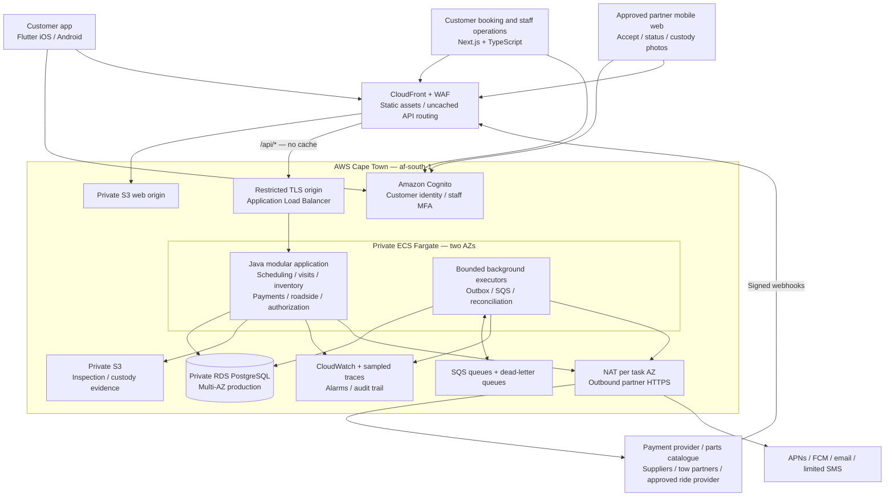
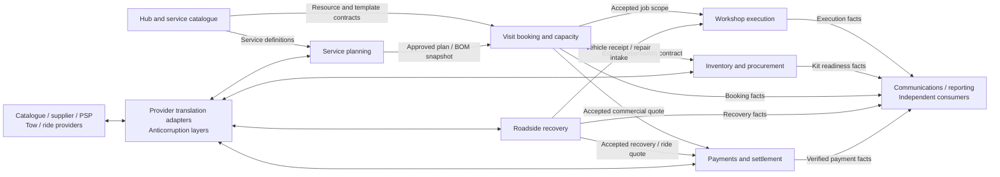
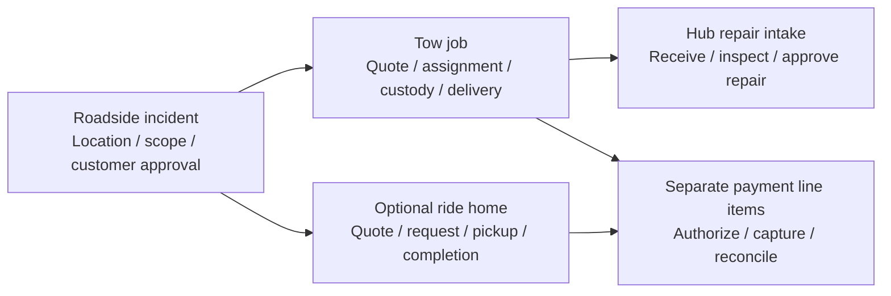

# Serv60 platform — high-level design

**Status:** proposed architecture for review; no booking or roadside backend is implemented by this document.

**Date:** 11 October 2026.

**Planning scope:** one South African hub, growing to ten hubs on a shared platform.

**Audience:** founders, engineering, hub operations and prospective delivery partners.

## 1. Architecture decision

Build the customer app in **Flutter**, the operations web app in **Next.js 16.4 with TypeScript**, and the transactional backend in **Java 25 LTS (Amazon Corretto) with Spring Boot 4.1.1**. Use **Spring Modulith 2.1.1 and ArchUnit** to verify module boundaries. Run the backend on **AWS ECS Fargate**, with **RDS PostgreSQL** as the authority for bookings, stock, payments and dispatch. Use **SQS and a transactional outbox** for reliable background work.

Use **Domain Driven Design (DDD)** to define models, business language and ownership, then start with a modular monolith: one backend application with enforced domain boundaries. Booking, resource allocation and parts reservation can then commit together in one database transaction. External payments, suppliers, towing and ride providers remain separate systems, coordinated through durable workflow records. Split a module into a service only when its scaling, ownership or availability requirements justify doing so.

The main engineering challenge is allocating scarce physical resources reliably. Autoscaling servers cannot create another barber, wash line or stocked oil filter. The app must offer appointments the hub can actually deliver.

### Technology choices

| Area | Decision | Reason and tradeoff |
|---|---|---|
| Customer iOS and Android app | Flutter, stable SDK pinned at implementation | One product codebase for booking, payments, maps and status. Test platform integrations on real devices. |
| Native integrations | Swift on iOS; Kotlin on Android where needed | Bridge a provider SDK or platform feature when its Flutter integration is inadequate. Two full native customer apps would increase delivery and maintenance effort. |
| Operations and customer web booking | Next.js 16.4 + TypeScript, App Router | Accessible calendar and responsive booking UI, typed API clients and reusable components. Version 16.4.0 is the latest stable release verified for this design; select the current supported security patch when building. |
| Core backend | Java 25 LTS, Spring Boot 4.1.1, JDBC/JPA as appropriate | Current LTS baseline inside Boot's documented support matrix and available as an AWS managed Lambda runtime. Spring's transaction, security, data and operations tooling fit this domain-heavy application. |
| Module verification | Spring Modulith 2.1.1 + ArchUnit | Enforce allowed dependencies, exposed contracts, no cycles and isolated module tests; separate Maven artifacts supply build boundaries. |
| Go | Deferred | Consider an independently deployed high-I/O partner or location gateway if measured traffic or team ownership warrants it. It is also a viable core language if the delivery team is substantially stronger in Go. |
| Rust | Deferred | Consider a profiled CPU-heavy scheduling optimizer or device integration. It does not remove the need for database transactions or provider reconciliation. |
| Database | RDS PostgreSQL, supported major version pinned at implementation | Resource ranges, stock ledgers, transactional consistency and relational reporting. PostGIS can support roadside coverage/matching after regional extension compatibility is checked. |
| Infrastructure definition | AWS CDK in TypeScript | Reuse team language skills for reproducible environments, IAM, networking, alarms and deployment. |

Do not introduce three backend languages at launch. Their independent pipelines, libraries and on-call knowledge would cost more than they save here. Pin supported security patches and upgrade the framework/JDK deliberately. [Next.js 16.4 release](https://nextjs.org/blog/next-16-4), [Amazon Corretto 25](https://docs.aws.amazon.com/corretto/latest/corretto-25-ug/what-is-corretto-25.html).

### Why Java 25 and Spring Boot

As of 11 October 2026, Java 27 is the latest general-availability feature release; Java 25 is the latest LTS. Java 27 is a valid choice for teams maintaining its shorter upgrade cadence. For Serv60, Java 25 offers a current long-lived baseline without needing a Java 27-specific feature. Spring Boot 4.1.1 is current stable and documents Java 17 through 26 compatibility; do not claim documented Java 27 support for this release. AWS lists a managed `java25` Lambda runtime, but no managed `java27`. These support boundaries favor Java 25 for the intended Fargate-to-Lambda options. [Java support roadmap](https://www.oracle.com/java/technologies/java-se-support-roadmap.html), [Spring Boot requirements](https://docs.spring.io/spring-boot/system-requirements.html), [Lambda runtimes](https://docs.aws.amazon.com/lambda/latest/dg/lambda-runtimes.html).

Quarkus remains a credible alternative for startup-sensitive or native-image workloads. Its build-time processing/native tooling motivated the earlier proposal, but no measured Serv60 requirement makes it necessary. Spring Boot also supports native images. For a continuously running booking/inventory service, Spring's mature ecosystem and explicit module tooling are a strong fit; framework memory/startup differences must be benchmarked rather than assumed to dominate cloud cost. [Quarkus native builds](https://quarkus.io/guides/building-native-image/), [Spring native-image support](https://docs.spring.io/spring-boot/system-requirements.html).

Spring Modulith 2.1.1's release explicitly upgrades to Spring Boot 4.1.1. Use this verified pairing for the design and validate the selected BOM/dependencies in the implementation build. [Modulith 2.1.1 release](https://github.com/spring-projects/spring-modulith/releases/tag/2.1.1).

## 2. Product scope and operating assumptions

The launch hub has four express maintenance bays, one mechanical repair bay and one additional automotive services bay. Barber, private workspace and massage are independently bookable services; they can also be combined with a vehicle visit. Massage requires a suitable room and qualified therapist to be included in launch planning.

The **60-minute target covers the entire eligible automotive visit**: check-in and inspection, scheduled maintenance, quality checks, wash and handover. Unexpected repairs and breakdown intake have separately assessed scope and timing. Eligibility depends on vehicle, job, staffing, equipment and verified parts readiness.

| Planning input | One hub | Ten hubs |
|---|---:|---:|
| Combined daily bookings, including lifestyle | 50 | 500 |
| Eligible express visits per hub/day | 20–28 | 20–28 |
| Monthly API requests, including staff refreshes | 200,000 | 2,000,000 |
| Active operations dashboards per hub | 2 | 2 |
| Dashboard refresh while visible | 30 seconds | 30 seconds |
| Roadside launch approach | Limited advertised service area/hours, approved partners, dispatcher | Expand coverage and dispatcher capacity with demand |

These are sizing assumptions, not demand forecasts or proven workshop capacity. Actual bay occupancy may be shorter than the complete visit. Throughput must be validated from each stage's duration, reset time, technician coverage and wash capacity. The app must not derive its sellable capacity from a headline number of bays.

Fleet accounts, subscriptions, loyalty, manufacturer partnerships and advanced optimization can follow the core launch. Automated diagnostics and nationwide 24/7 roadside coverage are outside this initial commitment.

## 3. System overview



The worker box is a logical responsibility. At launch, both application replicas can run bounded background consumers using durable database/SQS coordination. This avoids an idle extra service. Deploy the same Java artifact in a separate worker role when queue work begins competing with API latency, or integrations need independent limits. No worker relies on process memory for workflow progress.

Keep the existing investor website separate from this operational application. Its cinematic assets and public content can remain on their existing static hosting. No private booking records are embedded into exported HTML or build artifacts.

### DDD bounded contexts and ownership

A bounded context defines where a business model and its language apply. An aggregate protects a consistency boundary within that model; a Maven module organizes code; a service or Lambda determines deployment. These are separate decisions, not a one-to-one mapping. Candidate contexts below should be validated with the founder, hub manager, storekeeper and dispatcher through concrete scenarios/event storming. [Eric Evans DDD reference](https://www.domainlanguage.com/wp-content/uploads/2016/05/DDD_Reference_2015-03.pdf).

The core domain is delivering a feasible, parts-ready visit and executing it reliably; roadside recovery adds a second important customer journey. Supporting capabilities include fitment, stock and payments; managed identity and delivery infrastructure cover generic needs. Apply the richest modeling effort to eligibility, capacity, readiness, scope and dispatch decisions, rather than forcing every configuration screen into a complex aggregate.

| Bounded context | Owns |
|---|---|
| Identity and access | Customer profile, verified contact methods, organization membership, hub permissions and provider access |
| Hub and service catalogue | Physical bays, cubicles, rooms, chairs, equipment, capabilities, skills and versioned service definitions/templates |
| Visit booking and capacity | Resource calendars, opening hours, shifts, feasible visit plans, appointments, holds, allocations, accepted quotes, changes, cancellations and waitlists |
| Service planning | Vehicle identity relevant to servicing, verified fitment, approved maintenance scope and resolved service bill of materials |
| Inventory and procurement | Stock ledger, reservations, kits, purchase orders, receipts, quarantine and replenishment |
| Workshop execution | Check-in, work orders, actual occupancy, inspection, additional-work scope approval, quality checks and handover |
| Payments and settlement | Accepted quote references/snapshots, payment orders/intents, provider operations, deposits, authorizations, capture, refunds and reconciliation |
| Roadside recovery | Incidents, recovery quotes, towing offers, assignments, custody coordination and optional ride-home trips |
| Communications | Customer notification preferences, delivery requests and delivery attempts |
| Reporting | Operational projections and summaries; no authority to confirm bookings or consume stock |

Each module owns its writes and exposes application interfaces. Domain rules belong in Java, rather than being reimplemented in Flutter or Next.js. Module dependencies and architecture tests should prevent arbitrary cross-module database mutation. One shared database does not mean every module may update every table.

### Context relationships and language



This shows business interactions, not cyclic Maven dependencies. Application coordinators/process managers depend on the needed public APIs; core implementations never import each other's internals. Feedback such as verified payment or kit-readiness changes reaches the appropriate owner through explicit contracts and durable coordination.

Use a published language of immutable command/query DTOs and versioned integration events. External adapters translate provider statuses, errors, fitment codes and fees into Serv60 concepts: an Uber status or supplier part record must not become the internal domain model. Avoid a universal shared `Customer`, `Vehicle` or `Booking` JPA entity across contexts; use identifiers and the snapshots each context requires. Share only deliberately stable primitives.

The [ubiquitous language](../UBIQUITOUS_LANGUAGE.md) defines the canonical terms. A **Visit** is the customer's planned hub itinerary; an **Appointment** is one scheduled activity; a **Hold** is a temporary reservation. **Confirmed Booking** means capacity accepted under the disclosed policy, while **Ready for Express** additionally requires verified fitment and a complete usable kit. A **Work Order** describes actual automotive execution, and a **Roadside Incident** coordinates recovery independently from the customer's hub visit.

### Aggregate roots and business invariants

| Aggregate root / consistency authority | Invariants it owns |
|---|---|
| `VisitBooking` (the `visit` record) and `Hold` | Accepted selection/quote/policy, valid confirmation/expiry/cancellation transitions and bounded appointment references |
| `Appointment` and `ResourceCalendar` | Activity lifecycle and calendar version/rules; the reservation domain service and database range constraints prevent conflicting allocations across bookings |
| `ApprovedServicePlan` | Verified vehicle/fitment, approved service scope, immutable BOM/version and express eligibility inputs |
| `StockItem` and `StockReservation` | Hub/SKU quantities and ledger consistency; reserve/consume/release once; discrepancies create a readiness exception |
| `ServiceKit` and `PurchaseOrder` | Kit matches the approved BOM; readiness is revoked if incomplete; supplier order intent/result and receipt are explicit |
| `WorkOrder` | Only approved scope proceeds; stage transitions are valid; required QC passes before vehicle handover |
| `RoadsideIncident`, `TowJob` and `RideTrip` | Separate leg lifecycles, one active tow assignment and explicit resolution of customer transport |
| `PaymentOrder` / `PaymentIntent` | Currency/approved amount, capture/refund limits, valid transitions and durable external-operation identity |

These are proposed aggregate candidates, not a rule to create an aggregate for every table. Each root owns its behavior and references other roots by ID. Keep a visit small: it does not contain inventory, payment entities, tow jobs or every work-order event. Calendar allocations/history are indexed records queried over a bounded window, not an ever-growing object graph. Immutable value objects include a time interval, money with currency, approved quote snapshot, service-plan version and confirmed pickup location. [Vaughn Vernon on aggregate boundaries](https://www.dddcommunity.org/wp-content/uploads/files/pdf_articles/Vernon_2011_2.pdf).

Use aggregate methods for state changes such as `confirm`, `expire`, `approveScope`, `assignTow` and `markKitReady`. Domain services/policies determine visit feasibility, express eligibility, parts readiness and dispatch eligibility. Application services authorize the request, load facts, run the explicit transaction, invoke domain behavior and save roots/outbox records. Persisted process managers coordinate long-running payment, procurement and roadside outcomes and compensation. Supplier HTTP, SQS retries and framework transaction annotations stay outside the pure domain.

Internal domain events express known business facts. Examples are `VisitBundleHeld`, `BookingConfirmed`, `FitmentVerified`, `StockReserved`, `KitReady`, `KitReadinessRevoked`, `ScopeChangeApproved`, `QualityCheckPassed`, `VehicleHandedOver`, `TowAssigned`, `VehicleCollected`, `VehicleDelivered`, `RideCompleted` and `PaymentAuthorized`. Map relevant facts into versioned integration events; do not equate a framework event callback with durable delivery or emit a successful external outcome before it is known.

DDD does not require Kafka, event sourcing, separate databases or microservices. The launch model uses current state, an auditable stock/business history and an outbox. It deliberately commits booking and stock reservation across several aggregates/context APIs in one database transaction. This is an explicit consistency tradeoff, not one giant aggregate; the extraction plan below explains how to preserve it.

### Separate build modules, one initial deployment

Use a Maven multi-module build. Each business capability has an `-api` artifact and an `-impl` artifact; deployment composition roots assemble implementations. Two artifacts per capability are sufficient initially, without creating an artifact for every internal layer.

```text
backend/
  pom.xml
  modules/
    booking-api/                # commands, queries, values, errors, events
    booking-impl/               # domain / application / adapters
    inventory-api/
    inventory-impl/
    payments-api/
    payments-impl/
    roadside-api/
    roadside-impl/
    notifications-api/
    notifications-impl/
    ...catalogue, vehicles, workshop, access, reporting...
  runtimes/
    platform/                   # Boot HTTP API + launch background work
    worker/                     # thin composition root, deployed when justified
    notifications-lambda/       # future selected-module Lambda entry point
    roadside-service/          # future selected-module service entry point
```

This is a proposed layout, not folders/code already implemented. Inside each implementation:

- `domain` contains framework-independent business rules and value objects, without Spring, JPA, HTTP or AWS imports.
- `application` contains use cases and dependency ports; transaction orchestration is explicit.
- `adapters` contains REST, persistence, provider and messaging implementations. Never expose a JPA entity as a cross-module contract.
- Other capabilities depend only on exposed API artifacts/packages. Named interfaces and explicit allowed dependencies define the permitted graph; the runtime assembles implementations without importing their private repositories/entities.

CI must run Modulith structure verification, reject cycles/internal imports and use ArchUnit to check domain purity, repository ownership and transport separation. Isolated module integration tests prove each module's contract. A folder name alone does not establish a boundary. [Modulith verification](https://docs.spring.io/spring-modulith/reference/verification.html), [module interfaces](https://docs.spring.io/spring-modulith/reference/fundamentals.html), [module tests](https://docs.spring.io/spring-modulith/reference/testing.html).

Map artifacts into discoverable context packages, for example `com.serv60.booking.api` in `booking-api` and `com.serv60.booking.internal.domain`, `.application` and `.adapters` in `booking-impl`. Expose the API package as a named interface. Other contexts follow the same layout. Put the main composition root at `com.serv60.PlatformApplication` or explicitly configure module/component discovery; a main class under `runtime.platform` must not accidentally restrict scanning to runtime code. Build boundaries and package verification work together.

### Data ownership and the intentional transaction boundary

Give modules their own PostgreSQL schemas, migrations and repositories in the launch database. A module writes only its own schema; cross-module relationships use stable identifiers and application APIs rather than shared JPA entity graphs or private-table joins. Reporting builds projections. Record any necessary cross-schema foreign keys as explicit future extraction dependencies. Because the initial runtime uses one transaction manager/shared credentials, schema ownership is an architecture rule enforced by tests/review, not independent database security isolation.

A visit coordinator starts one short transaction and calls scheduling and inventory APIs through the same datasource/transaction manager. Scheduling allocations, stock reservations and integration outbox records commit or roll back together. The inventory module never calls scheduling back; dependencies remain acyclic. External HTTP/AWS/provider calls remain outside this transaction.

That shared transaction is intentional. Separately built modules do **not** make independently deployed booking and inventory services a zero-effort change. The safest later split keeps scheduling and stock reservation together in one reservation service, while procurement and reporting can move separately. This may host two contexts with an explicit shared transaction; the service name alone does not unify their models. Strict context transaction independence requires remodeling the jointly atomic capabilities/data authority into a single Reservation context, or using durable provisional reservations, expiry, saga compensation and reconciliation across independent owners. Never display a confirmed ready-stock booking until all required reservations are durable. [Saga orchestration](https://docs.aws.amazon.com/prescriptive-guidance/latest/cloud-design-patterns/saga-orchestration.html).

### Lambda and microservice extraction plan

Reuse domain/application code through a new composition root. An HTTP service provides REST adapters; a Lambda provides a handler or compatible Spring Cloud Function adapter. Package only the selected modules and dependencies, not the entire platform for each function. Lambda is an execution model, not a requirement to create a service for every endpoint. [Spring Cloud Function AWS adapter](https://docs.spring.io/spring-cloud-function/reference/adapters/aws-intro.html).

| Candidate | Likely destination | Work beyond repackaging |
|---|---|---|
| Notifications, reminders, evidence processing, reporting projections | SQS/S3-triggered Lambda where duration/cost fit | Trigger contracts, deduplication, permissions, retry/DLQ, scheduling and observability |
| Supplier/partner adapters and webhook processing | Lambda or independent worker | Durable operation ownership, unknown-result reconciliation and provider limits |
| Roadside coordination | Independent service when its operations/scaling justify it | Incident/assignment data ownership, versioned APIs/events and integration with receiving hubs/payments |
| Scheduling + stock reservation | Keep together initially; later a reservation service | Preserve atomic invariants; a true separation needs the saga described above |

Before extraction, require versioned OpenAPI/JSON event contracts, isolated tests, owned data, deadlines/idempotency, failure handling, alarms and a recovery plan. Backfill and reconcile the new owner's data, then switch to **one authoritative writer** using controlled routing. Do not introduce permanent dual writes or remote calls inside the old database transaction. Network latency, authorization propagation, outages and data migration are real additional work even when business logic is reusable. [Strangler migration](https://docs.aws.amazon.com/prescriptive-guidance/latest/cloud-design-patterns/strangler-fig.html).

## 4. Customer app and staff web experience

### Customer journey

1. Select a hub, add or select a vehicle, enter mileage, and choose an eligible service or a repair assessment.
2. Optionally add barber, private work or massage. Show a combined visit timeline and price, including any longer customer stay. Presence-dependent appointments for the same person must be sequential with walking buffers; a haircut and massage cannot overlap. A workspace rental may intentionally span another activity if the customer accepts that reserved interval and price.
3. Browse feasible combinations. The result includes availability freshness, parts readiness status and any conditions requiring review.
4. Temporarily hold the complete selection, approve the quote and deposit policy, then complete payment if required.
5. Receive an explicit confirmation, arrival instructions and booking reference. Show a hold countdown only before confirmation.
6. Check in by QR/reference, track actual job milestones and approve any additional work or price before it starts.
7. Receive completion notice, pay the agreed balance, collect the vehicle and access the invoice/service history.

Allow lifestyle-only bookings and web booking for customers who do not install the app. A linked visit groups related appointments; each provider still has its own appointment and cancellation policy. The confirmation clearly states whether the customer requires the whole bundle or allows optional appointments to be booked separately. Never silently confirm only part of an all-or-none selection.

For example, a 09:00–10:00 car visit might include a 09:10–09:40 haircut or a 09:05–09:50 workspace reservation. A 60-minute massage plus walking time cannot automatically fit inside it: offer a shorter session or show a later personal departure time.

### Flutter structure

Organize features into account/vehicles, booking, visit status, payments and roadside. Use views and view models for UI state, repositories for API/local state, and platform services for maps, notifications, secure storage and payments. Generate typed models/clients from the backend OpenAPI contract. This follows Flutter's separation of UI and data responsibilities. [Flutter architecture guide](https://docs.flutter.dev/app-architecture/guide).

The backend remains authoritative. Cache service descriptions and the customer's confirmed booking for viewing; show freshness when offline. Persist the idempotency key for an in-progress command so reconnection queries or retries the same operation. Do not replay a queue of new bookings or roadside dispatches automatically when connectivity returns.

Use one-time location permission for breakdown pickup, with a manual pin/address fallback. Continuous customer background GPS is unnecessary. Native bridges are available for SDKs that require them; validate permissions, lifecycle, notification delivery and payment redirects on physical iOS and Android devices. [Flutter platform channels](https://docs.flutter.dev/platform-integration/platform-channels).

### Operations web UI

The calendar has selectable resource columns: bays, technicians, wash, barber chairs/providers, massage rooms/therapists and private workspaces. Staff configure recurring opening hours, shifts, breaks, service eligibility, duration, reset buffers, equipment outages and date-specific closures.

Display held, confirmed, parts-pending, kit-ready, checked-in, in-progress, delayed and completed appointments with text labels as well as colour. Include:

- A day board showing the full vehicle pipeline and current physical occupancy.
- A parts queue for fitment review, missing stock, expected receipts and tomorrow's kits.
- An exception queue for overruns, absent staff, failed equipment and supplier delays.
- A roadside board for quotes, unmatched incidents, accepted trucks, vehicle arrivals and ride issues.
- Capacity previews and impact lists before publishing calendar changes.

Drag-and-drop is a request to the server to reschedule; it is not a direct calendar mutation. Customer bookings, staff bookings and walk-ins use the same constraints. Staff cannot override a physical conflict by changing a UI colour. Publish calendar changes with an expected version; return a conflict when another user has changed it. Normal shift/closure edits that invalidate confirmed appointments require an explicit resolution plan before publication. Emergency outages block new sales immediately while retaining existing obligations in an exception queue; they do not silently erase appointments.

Choose static-exported Next.js shells hosted on S3/CloudFront initially. Calendar and customer records load at runtime from Java APIs; availability responses use `Cache-Control: no-store`. Use one application origin: CloudFront routes web assets to private S3 and `/api/*` to the Java ALB. API/auth behaviors have zero minimum/default/maximum cache TTLs and forward required authorization headers, session cookies, query parameters and command methods. Restrict direct origin access so clients use the protected ingress. [CloudFront origin forwarding](https://docs.aws.amazon.com/AmazonCloudFront/latest/DeveloperGuide/RequestAndResponseBehaviorCustomOrigin.html).

Static exports do not support request-time SSR or Server Actions. Use ordinary API commands and prebuilt routes; dynamic IDs can be route/query state within a prebuilt page. If SSR later adds clear value, Vercel or a separate Node runtime is an option, with an additional bill and a reviewed data-processing region. [Next.js static export](https://nextjs.org/docs/app/guides/static-exports).

## 5. Availability and double-booking prevention

### Resource model

| Service | Required resources |
|---|---|
| Express maintenance | Eligible bay, qualified technician capacity, QA, wash and handover capacity |
| Mechanical repair | Repair bay, technician and job-specific equipment; assessed duration |
| Additional automotive service | Compatible sixth bay, technician and equipment |
| Barber | Chair **and** available barber |
| Massage | Room **and** qualified therapist |
| Private work | Individual cubicle |
| Coffee preorder | Preparation/pickup capacity if constrained; ordinary lounge access initially does not require a slot |

Treat each exclusive unit as a schedulable resource. Pooled staff capacity must be represented by real qualified staff or explicit capacity units backed by a roster. Do not multiply nominal headcount across simultaneous jobs.

Store allocations as UTC timestamp ranges `[start, end)`, plus the hub's IANA timezone, such as `Africa/Johannesburg`, for local business hours and display. Include cleaning, reset and walking buffers. Versioned service templates specify stage offsets, durations, skills, equipment and parts. A five- or fifteen-minute picker is a UI increment, not a concurrency guarantee.

Illustrative eligible express timeline:

| Offset from arrival | Stage | Reserved capacity |
|---|---|---|
| 00–05 | Check-in and initial inspection | Intake/inspection staff; bay where applicable |
| 05–40 | Scheduled maintenance | Service bay and qualified technician(s) |
| 40–45 | Quality check | Bay/QA capacity |
| 45–55 | Wash | Wash line and staff |
| 55–60 | Handover | Handover capacity |

One wash line cannot wash four cars arriving at minute 45 together. A starting plan might stagger arrivals at 09:00, 09:15, 09:30 and 09:45, reserving wash times at 09:45, 10:00, 10:15 and 10:30. Reset time and real operating measurements still determine feasibility. The planner reserves downstream stages when the customer books, not when the car reaches the wash.

### Atomic hold and confirmation

Availability reads generate bounded candidate combinations for a requested date range. They are advisory. Only a transaction on the primary database can accept a reservation.

```mermaid
sequenceDiagram
    participant App as Flutter / web
    participant API as Java API
    participant DB as PostgreSQL primary
    participant Pay as Payment provider
    participant Work as Outbox / worker
    App->>API: Find feasible visit combinations
    API->>DB: Read calendars, allocations and stock
    API-->>App: Candidate times + quote conditions
    App->>API: CreateHold + Idempotency-Key
    API->>DB: Lock hub schedule; expire overdue holds
    API->>DB: Reserve full calendar bundle + policy-specific parts/demand
    DB-->>API: Commit complete bundle + hold expiry
    API-->>App: Hold reference and server expiry
    API->>Pay: Start payment using durable operation reference
    Pay->>API: Verified payment result / signed webhook
    API->>DB: Lock hub then hold; recheck expiry and policy conditions
    API->>DB: Confirm booking + write outbox, then commit
    API-->>App: Confirmed booking, or explicit resolution state
    Work->>DB: Claim pending outbox work
    Work-->>App: Notification; app fetches authoritative state
```

For launch, serialize scheduling writes through a locked per-hub scheduling row. Within that short transaction, expire overdue holds, validate calendars, choose compatible resources, lock relevant stock balances in a fixed order and reserve the requested bundle according to its disclosed parts policy. Different hubs proceed independently. Creation, confirmation, cancellation, expiry, rescheduling, walk-ins and calendar publication use the same lock order: hub scheduling row → hold/booking → ordered resource/stock records. The expiry sweeper must not reverse it. Inventory-only operations take ordered stock locks and must not subsequently acquire the scheduling lock.

There are two explicit paths:

- **`READY_STOCK`:** verified fitment, all resources and all required usable stocked parts commit atomically. A shortage rejects the entire required bundle.
- **`CONDITIONAL_PROCUREMENT`:** all required appointments, available known parts, missing-parts demand/review records and a readiness deadline commit atomically. The customer accepts a conditional appointment; it cannot produce `READY_FOR_EXPRESS`. Unverified fitment enters staff review or an assessment/provisional scope rather than unconditional express eligibility.

Use database exclusion constraints as an independent guard against overlapping active allocations for the same organization/resource. Half-open ranges permit adjacent appointments; reset buffers create the necessary gap. Narrow the scheduling lock only after contention is measured. [PostgreSQL range types](https://www.postgresql.org/docs/current/rangetypes.html), [exclusion constraints](https://www.postgresql.org/docs/current/ddl-constraints.html), [row locking](https://www.postgresql.org/docs/current/explicit-locking.html).

Start with a configurable **five-minute hold**, using database time. An active hold must explicitly become `EXPIRED`, `RELEASED` or `CONFIRMED`; a sweeper and the next booking attempt perform expiry. Do not depend on an in-memory timer, Redis TTL, or a volatile `expires_at > now()` index predicate. Apply per-customer/device limits to prevent stock and slots being hoarded.

Payment calls happen outside database locks. Persist a payment intent before calling the provider. Only a verified provider result can advance payment state; a customer's redirect/success screen is insufficient. If payment succeeds after expiry, reacquire a valid complete bundle for the same accepted time, selected providers, scope and quote conditions before confirmation. Any material change requires fresh customer consent. If the accepted selection is unavailable, void/refund the payment and offer alternatives. Never take capacity from another confirmed customer.

Rescheduling with no payment difference atomically replaces allocations and adjusts parts. Where additional payment is required, preserve the original booking and store a proposed replacement plan. Reserve only incremental resource intervals and additional SKU quantities, reusing the customer's original protections. This permits a same-bay overlapping move and avoids demanding a second identical kit when no free stock remains. On successful confirmation, atomically rebuild the final allocations and transfer/release parts reservations. On expiry/failure, release only the increments. A cancellation releases resources and parts once, while refunds may continue asynchronously.

Keep planned allocations separate from actual occupancy. A late-running car physically blocks its bay even if its planned end time has passed. Staff must resolve the affected appointments, communicate a revised arrival/finish time and record approved scope changes. The system must not automatically promise an impossible new start.

## 6. How the booking tells the hub which parts to stock

### Vehicle-to-parts planning

The chain is **verified vehicle → approved service template → resolved parts list → inventory reservation or procurement → picked kit**.

Collect VIN/registration, market, make/model/year, engine/variant, transmission, mileage and service history. A VIN or registration lookup assists identification; it is not sufficient proof of exact fitment. Resolve parts through a licensed supplier/OEM catalogue or staff review. Record the catalogue version, approved part identifiers, quantities, oil grade/manufacturer approval and permitted substitutions. Ambiguous vehicles require review; never guess fitment using generative AI.

For example, a selected oil service yields a vehicle-specific filter and sealing parts plus the specified quantity/grade of oil. The booking references that resolved bill of materials. It does not reserve a generic “filter” without knowing which one.

Launch with a limited, validated service/vehicle catalogue, manual fitment verification and supplier CSV imports if commercial APIs are unavailable. Add live supplier adapters only after their fitment coverage, stock accuracy, licensing, lead times and order semantics are validated. Catalogue contracts and costs are procurement inputs still to be decided.

### Inventory authority

Track stock by organization, hub, SKU and relevant lot/serial/location. Maintain an auditable movement ledger with transactionally updated balances. Distinguish usable on-hand, reserved, quarantined, in-transit and consumed stock. A reservation is not consumption.

`available_to_reserve = usable_on_hand − active_stock_reservations`

Reserve all stocked parts required by an eligible job in the same transaction as its resource bundle. Inventory receipts, adjustments and consumption also lock the affected balances and validate quantities. Parts at hub A cannot make a booking at hub B ready. Hub transfers require shipment and receipt, not a balance relabel.

Incoming supplier allocations are separate from on-hand stock. An order and an estimated delivery do not prove that the right part has arrived. Model three distinct concepts:

| Status | Customer and operational meaning |
|---|---|
| Appointment confirmed | Capacity is reserved under the disclosed booking policy |
| Parts pending | Fitment, stock or procurement is unresolved; show the conditional status and next update |
| Ready for express | Exact fitment verified and a complete usable kit reserved at the correct hub |

Default the express booking screen to `READY_STOCK` options. For a later `CONDITIONAL_PROCUREMENT` appointment, disclose the condition and use a staff-reviewed policy with a parts-readiness deadline. Do not present a pending kit as an unconditional express commitment. Record whether lifestyle appointments should remain or change with the vehicle booking, including any independently incurred cancellation fees. If the deadline is missed, offer rescheduling or another explicitly approved service scope under that disclosed policy, with the appropriate payment resolution.

A pending-fitment appointment initially refers to a **Provisional Service Scope**, not an approved verified plan. When review resolves it, persist the approved plan/version and revalidate eligibility, parts and the resource timeline. Material scope, timing or quote changes require customer consent before the appointment can become ready.

### Staff readiness and replenishment

Confirmation produces a procurement/kit task through the outbox. A storekeeper sees tomorrow's jobs, required parts, missing items, expected receipts and review deadlines. Staff receive and verify deliveries, scan or confirm the picked kit against the job, and record actual technician consumption. Unused items return through a controlled movement; faulty or uncertain stock is quarantined.

Replenish common consumables using lead-time demand, safety stock and confirmed appointment demand. Buy rare vehicle-specific parts against actual appointments. Count current reservations and incoming orders once to avoid double ordering. Maintain minimum/maximum levels per hub, supplier lead times and an exception queue for delayed deliveries or failed counts.

Purchase-order creation needs the same protection against duplicate external effects as payments: persist the order intent, use a supplier idempotency facility where guaranteed, and reconcile ambiguous results before ordering again. Cancellation detaches booking demand and reconciles any existing supplier order; it does not assume that an external order was cancelled or that non-returnable costs are recoverable. A supplier ETA change or stock discrepancy revokes readiness for affected kits and creates an operational/customer update.

## 7. Direct-pay roadside assistance and getting the customer home

Roadside is a **direct-pay coordination service**. The customer can approve a tow without submitting an insurance claim. Launch with approved regional towing partners and a staffed dispatch console; publish actual operating hours and coverage. The business needs provider contracts and dispatcher coverage before advertising the feature.

### Customer flow

1. Confirm callback number, pickup pin/address, vehicle, fault, drivability and immediate circumstances. Surface appropriate emergency escalation for injuries or immediate danger; mechanical dispatch is not emergency medical/police response.
2. Collect recovery requirements: locked wheels, EV handling, road/access restrictions, passengers, accessibility and equipment needs.
3. Quote callout, destination/distance, included recovery work, cancellation/waiting policy and possible changes. Obtain explicit approval for direct payment and scope. Additional charges require approval.
4. Authorize the agreed payment if the selected provider supports it; show the real payment/dispatch state.
5. Assign one approved compatible towing partner. Show confirmed company/driver/truck details, ETA and incident reference. Do not show “truck confirmed” while still searching.
6. Confirm the destination and its receiving/parking capacity before approving collection/departure. If it cannot receive the car, obtain approval for another destination and any changed quote. Confirm pickup with an incident code, vehicle-condition photos and custody handover.
7. If towing to Serv60, create a repair intake and notify the receiving hub. Inspection determines the repair job; a breakdown does not automatically receive an express slot.
8. Offer a separately quoted ride home. Confirm passenger needs and a suitable pickup point, which can differ from the car's location. Request it when the customer is ready and custody is understood.
9. Track towing and the ride independently, then reconcile vehicle receipt, ride outcome and charges.

The ride option provides practical safeguards: confirmed driver/vehicle identity, PIN where supported, consented trip sharing and dispatcher contact. It cannot guarantee personal safety or driver availability. Do not direct the customer to an unidentified vehicle, leave them assuming an unconfirmed ride is coming, or treat a tow completion as proof that they reached home.

### Uber integration boundary

Uber for Business operates in South Africa, but **Serv60 must obtain the relevant business API access and confirm product/area coverage**. Guest Rides access is provisioned commercially per API/scope. It is not an unrestricted consumer ride-booking API. Guest Rides can serve riders without their own Uber account; organization credentials remain on the backend. [Business API access](https://developer.uber.com/docs/organizations/about/u4b-api-introduction), [South Africa business offering](https://businesses.uber.com/uber-for-business-sa.html), [Guest Rides overview](https://developer.uber.com/docs/guest-rides/guest-ride-api-build-guide/overview).

If approved, a dispatcher can initially use Uber Central, followed by an API adapter. Otherwise use an approved local transport partner or a customer-initiated ride-hailing handoff. Show who orders and pays, and do not promise Serv60 tracking for a ride booked independently. [Uber Central access](https://help.uber.com/am/business/article/accessing-uber-health-or-uber-central?nodeId=07f4a003-346a-478a-91eb-692bd6443a42).

The Guest Trip API supports fare selection, PIN verification and consented contacts. Its supplied rider tracking URL must open externally rather than being embedded. Frequent driver-location webhooks are region/access dependent; the launch UI can use status/ETA plus external tracking. [Create Guest Trip](https://developer.uber.com/docs/guest-rides/references/api/v1/guest-trips-post), [tracking response](https://developer.uber.com/docs/guest-rides/references/api/v1/guest-trips-request_id-get), [driver-location access](https://developer.uber.com/docs/guest-rides/references/api/webhooks/driver-location).

### Durable dispatch and independent legs



Match partners by declared operating availability, coverage zone, current capacity and required recovery equipment. At launch, dispatcher-assisted matching and a small partner mobile web interface are sufficient. Record verified partner identity, capabilities, rate cards, documentation expiry and contact channels. Do not require every independent tow company to build an API.

Create expiring offers with provider identity and a dispatch generation. Accept an offer in a PostgreSQL transaction that validates `offer.expires_at > database_time`, the current dispatch generation, job version, eligibility and provider capacity. A constraint enforces one active assignment per tow job. Expired/stale acceptances fail even if the expiry worker has not run; manual dispatcher actions follow the same rules.

Once a provider has accepted, a late heartbeat or ETA is **not** permission to send another truck. Contact and cancel/reconcile the existing assignment before replacement. Increment the dispatch generation on approved reassignment so old commands cannot affect the new truck.

| Workflow | Representative states |
|---|---|
| Incident | `SUBMITTED → TRIAGED → APPROVED → COORDINATING → RESOLVED`; `NEEDS_DISPATCHER` branch |
| Tow | `QUOTED → AUTHORIZED → SEARCHING → ASSIGNED → EN_ROUTE → ARRIVED → COLLECTED → DELIVERED → CLOSED` |
| Ride | `NOT_REQUESTED → QUOTED → APPROVED → REQUEST_PENDING → CONFIRMED → IN_PROGRESS → COMPLETED` |
| External operation | `INTENT_RECORDED → IN_FLIGHT → SUCCEEDED / FAILED / RESULT_UNKNOWN → RECONCILED` |

Cancellation, disputes, unavailable providers and refund work are explicit branches. A parent incident is resolved only after its required legs are fulfilled or the customer/dispatcher explicitly records an accepted alternative or waiver. A terminal failed/no-driver ride is a known result but leaves customer transport unresolved. A failed ride does not cancel an already collected vehicle's tow.

**Unknown external results are a critical failure case.** The reviewed Uber trip-create documentation does not provide a general idempotency-key guarantee. If a create call times out after it may have succeeded, persist `RESULT_UNKNOWN`, reconcile via webhooks/provider records/dashboard and escalate unresolved ambiguity. Do not blindly create another ride or fallback trip. A correlation memo helps investigation; it is not an idempotency guarantee. [Trip listing](https://developer.uber.com/docs/guest-rides/references/api/v1/guest-trips-get).

Verify provider webhook signatures, persist before acknowledgement, deduplicate and handle out-of-order events. Fetch/reconcile authoritative provider state where needed. Never regress a terminal state from a stale event. Allowlist provider resource hosts before following a webhook URL. [Uber webhook behavior](https://developer.uber.com/docs/guest-rides/guides/webhooks).

Uber Central is organization-paid. Decide whether Serv60 absorbs the ride or passes its approved cost to the customer; reconcile the final receipt and fare policy before final billing. Tow and ride cancellation fees and charges remain separate line items. [Uber Central business overview](https://www.uber.com/us/en/business/welcome/).

Store only the location detail needed for an active incident/available partner. Coalesce frequent partner updates and keep a deliberately limited location trail. Include observation time/accuracy, reject older updates overwriting a newer position, and label stale/unavailable locations and ETAs. GPS loss prompts contact/reconciliation rather than an invented live position. Use notifications plus refresh while the incident screen is visible; add WebSockets only when active concurrency warrants them.

## 8. Data, API and consistency contracts

### Principal records

| Group | Main records |
|---|---|
| Access and hub catalogue | `organization`, `hub`, `membership`, `customer`, `resource`, `service_template` |
| Service planning | `vehicle`, `provisional_scope`, `approved_service_plan`, `fitment_resolution`, `service_bom` |
| Visit booking and capacity | `visit`, `appointment`, `hold`, `resource_allocation`, `visit_quote`, `booking_change`, `shift`, `calendar_exception` |
| Inventory and procurement | `stock_balance`, `stock_movement`, `stock_reservation`, `kit`, `purchase_order`, `supplier_operation` |
| Workshop | `repair_intake`, `work_order`, `stage_event`, `actual_occupancy`, `inspection`, `scope_approval`, `quality_check`, `handover` |
| Roadside | `incident`, `recovery_quote`, `tow_job`, `dispatch_offer`, `provider_assignment`, `ride_trip`, `custody_event` |
| Payments and settlement | `payment_intent`, `provider_operation`, `accepted_quote_reference`, `capture`, `refund` |
| Technical reliability, scoped to the owning context/producer | `idempotency_record`, `outbox_event`, `consumer_receipt`, `webhook_receipt`, `audit_event` |

`repair_intake` belongs to Workshop Execution; Roadside supplies the vehicle-arrival contract. Shared technical bookkeeping in the launch database must retain producer/owner identity and move with the owner during extraction; it is not a shared business-entity model.

Separate lifecycle state from readiness and stage progress. An appointment may be confirmed but parts-pending; a work order may be in progress while one optional lifestyle appointment has completed. Avoid one status field that conflates all of these.

Every organization-owned record carries organization scope; operational data carries hub scope where applicable. Foreign keys and constraints must prevent linking records across organizations/hubs accidentally. Represent money as integer minor units with currency, never floating point. Persist quote/template/fitment versions so a later catalogue edit cannot silently change an accepted booking.

### Representative API surface

| Command/query | Contract |
|---|---|
| `GET /v1/hubs/{hubId}/availability` | Bounded date range and service filters; feasible bundles and freshness; no personal information |
| `POST /v1/visit-holds` | Idempotency key, vehicle/services/time selection; atomic bundle result and server expiry |
| `POST /v1/holds/{holdId}/confirm` | Validates payment and reservation state; cannot trust a client payment flag |
| `POST /v1/visits/{visitId}/reschedule` | Expected version, replacement selection, idempotency; preserves original on failure |
| `POST /v1/visits/{visitId}/cancel` | Idempotent cancellation and separate payment-resolution state |
| `PUT /v1/hubs/{hubId}/calendar` | Staff authorization, expected version, conflict/impact validation |
| `GET /v1/hubs/{hubId}/parts-readiness` | Authorized staff worklist, bounded/paginated |
| `POST /v1/roadside-incidents` | Location, vehicle, callback and approved request; idempotent incident reference |
| `POST /v1/tow-jobs/{jobId}/accept` | Partner identity, offer/generation/version; one valid winner |
| `POST /v1/incidents/{incidentId}/ride-home` | Customer approval of separate ride quote; durable external operation |
| `POST /v1/webhooks/{provider}` | Raw-body signature verification, durable receipt and asynchronous processing |

Generate OpenAPI clients for Dart and TypeScript. Use additive API changes, cursor pagination, structured errors and request IDs. Slot conflicts return alternatives rather than a generic server error; unknown partner/payment outcomes return a pending-resolution state, not a false failure.

Scope idempotency records by authenticated principal/organization and operation. Store a payload hash: the same key with a changed request returns a conflict. Preserve durable business references even after the response-replay retention window expires. Optimistic versions protect ordinary edits; database transactions/constraints protect scarce capacity.

### Reliable background work

Commit a state change and outbox event together. A publisher leases batches, publishes to SQS, and marks publication after acknowledgement. A crash can publish twice, so consumers record processed event identity with their local effects. External effects also require durable operation intents and provider-specific idempotency or reconciliation. [AWS transactional outbox](https://docs.aws.amazon.com/prescriptive-guidance/latest/cloud-design-patterns/transactional-outbox.html).

SQS Standard delivery is at least once. Use per-aggregate versions and authoritative state checks instead of assuming event arrival order. Use FIFO only when a particular workflow benefits from ordered processing; it does not make an external charge or order exactly once. Configure bounded retries, visibility timeouts, dead-letter queues and audited replay. [SQS delivery semantics](https://docs.aws.amazon.com/AWSSimpleQueueService/latest/SQSDeveloperGuide/standard-queues-at-least-once-delivery.html).

Reminder schedules, hold expiry and stuck-operation checks are persisted with due times. Multiple workers safely claim due work; a process-local timer is never their sole owner. Notifications and reporting can be eventually consistent. Capacity, stock reservations, accepted financial state and active dispatch assignment require transactional correctness.

Spring Modulith supports module structure and internal listener testing, but do not assume an application event or listener annotation implements the required SQS delivery contract. Retain the explicit leased PostgreSQL-to-SQS integration outbox and consumer receipts. Use a stable JSON envelope with event ID/type, schema version, aggregate ID/version, occurrence time, validated organization/hub scope and correlation/causation IDs. Never serialize JPA entities or use Java class names as the external wire contract. [Modulith event publication/externalization](https://docs.spring.io/spring-modulith/reference/events.html).

## 9. AWS deployment and cloud cost

### Recommended revenue-serving deployment

Use Cape Town (`af-south-1`) for the primary application/database, with a CloudFront-protected TLS ALB spanning two availability zones, two private Fargate application replicas and a private RDS PostgreSQL Multi-AZ deployment. Set minimum desired count to two with one healthy task per AZ, enable ECS AZ rebalancing and provision sufficient surviving capacity for the agreed load. Start with 0.5 vCPU and 1–2 GB per replica, then measure heap, CPU, p95 latency and connection use. Select the supported RDS class from a load test, not just the lowest listed price. [ECS AZ rebalancing](https://docs.aws.amazon.com/AmazonECS/latest/developerguide/service-rebalancing.html).

On shutdown, stop acquiring worker leases, drain bounded work, and let incomplete leases/SQS visibility timeouts recover. Protect outbox/provider intents from process termination; graceful shutdown improves latency but does not supply durability.

Use bounded JDBC connection pools (normally HikariCP with the selected Spring Boot JDBC/JPA starters). Set a total connection budget across maximum API replicas, background work, migrations and maintenance. Reserve headroom before increasing ECS task count. Use short transactions and bounded executor queues; autoscaling must not overwhelm the database. Validate Spring heap, startup and pool sizing before treating the compute budget as sufficient. [Spring datasource/pooling](https://docs.spring.io/spring-boot/reference/data/sql.html).

Outbound payment/supplier/tow/push HTTPS uses a NAT gateway in each task AZ for the production availability target. A single NAT is a pilot saving with an explicit egress failure point. Use an S3 gateway endpoint and direct authorized uploads to avoid proxying photos through the application/NAT. Add paid interface endpoints only where their availability/security benefit and hourly cost justify them. [AWS outbound networking](https://docs.aws.amazon.com/AmazonECS/latest/developerguide/networking-outbound.html).

S3 has separate private buckets/prefix policies for evidence and web assets, encryption, blocked public access and lifecycle retention. Enable evidence versioning and an appropriate recovery/retention policy; database backups alone do not recover deleted photos. Web assets use CloudFront origin access control; evidence uses short-lived signed access after authorization. Bound upload size/type and scan evidence before making it available to other users.

Use Cognito, SQS, Secrets Manager, CloudWatch, ECR, KMS and WAF with least-privilege roles. Verify chosen instance classes, database extensions and service features in Cape Town during the infrastructure spike. Core Fargate and RDS Proxy regional support is documented; AWS currently also supports SnapStart in Cape Town. [Fargate regions](https://docs.aws.amazon.com/AmazonECS/latest/developerguide/AWS_Fargate-Regions.html), [RDS Proxy regions](https://docs.aws.amazon.com/AmazonRDS/latest/UserGuide/Concepts.RDS_Fea_Regions_DB-eng.Feature.RDSProxy.html), [SnapStart availability](https://docs.aws.amazon.com/lambda/latest/dg/snapstart.html).

### Planning budget

The following numbers are **engineering allowances in USD/month**, not retrieved Cape Town price quotes or committed capacity guarantees. They assume 730 hours/month, no credits/free tier, modest evidence/media traffic, static web hosting and the request volumes in section 2. Validate an itemized Cape Town estimate in AWS Pricing Calculator before approving spend.

| Component | One-hub single-AZ pilot | One-hub production HA | Ten-hub shared production |
|---|---:|---:|---:|
| Fargate application and bounded background work | $30–50 | $60–120 | $100–250 |
| ALB and traffic | $20–40 | $25–60 | $30–90 |
| RDS, storage and backup allowance | $50–100 | $180–350 | $300–650 |
| NAT and egress processing | $45–80 | $90–160 | $90–200 |
| Logs, alarms and sampled traces | $15–40 | $20–60 | $40–120 |
| S3 and CloudFront web hosting | $5–20 | $5–30 | $10–60 |
| Cognito, SQS, secrets, WAF/KMS and miscellaneous | $10–30 | $15–40 | $25–80 |
| Public IPv4 allowance | $11–18 | $15–25 | $15–40 |
| **Rounded envelope including modest contingency** | **$200–400** | **$450–900** | **$750–1,600** |

The pilot trades away AZ resilience and is intended for controlled validation. Use the production profile when the hub relies on this system for revenue. Multi-AZ database and duplicated egress create a fixed cost floor; these costs do not multiply by ten when ten hubs share the platform.

These envelopes exclude **payment fees, OTP/SMS, maps/routes, fitment-data licensing, tow charges, ride fares, inventory purchases, human dispatch/support, staging environments, cloud support plans and taxes**. A dedicated worker or SSR UI runtime is additional. Estimate these separately in business unit economics; roadside transport and staffing will often exceed its cloud request cost.

Use this worksheet with actual regional rates:

- Fargate: `730 × task count × (vCPU × CPU-hour rate + memory GB × GB-hour rate)`.
- RDS: `730 × selected deployment-hour rate + storage + chargeable backup/IO`. Do not double-count standby cost if the quoted rate already covers Multi-AZ.
- NAT: `730 × NAT count × gateway-hour rate + processed GB × processing rate + applicable transfer`.
- ALB: `730 × ALB-hour rate + LCU-hours × LCU rate`.
- Public IPv4: `730 × chargeable address count × $0.005/hour`; AWS publishes this rate for commercial regions.
- Logs and media: ingestion, retention, requests and transferred bytes; account for all environments.

[Fargate pricing](https://aws.amazon.com/fargate/pricing/), [RDS pricing](https://aws.amazon.com/rds/postgresql/pricing/), [ALB pricing](https://aws.amazon.com/elasticloadbalancing/pricing/), [NAT/IPv4 pricing](https://aws.amazon.com/vpc/pricing/), [CloudWatch pricing](https://aws.amazon.com/cloudwatch/pricing/), [AWS Pricing Calculator](https://calculator.aws/).

### Why Fargate rather than Lambda everywhere

Java Lambda with SnapStart, HTTP API and RDS Proxy is a valid low-traffic alternative. It may reduce idle application compute. It does not eliminate the database, egress, proxy, security or observability floor. Fargate gives this transaction-heavy launch predictable warm latency, bounded connection pools and straightforward background/provider work.

Java 25 is a managed Lambda runtime. For extracted event/use-case handlers, use the Spring Cloud Function AWS adapter through a Boot-compatible Spring Cloud BOM or a thin AWS handler. Confirm the actual version combination and packaged behavior in an integration spike; do not copy older Boot dependency versions from example snippets. Load only required beans, bound concurrency/connections, and retain schedules in durable queues/database rather than a frozen execution environment. Moving the existing HTTP app to Lambda and extracting a genuinely independent domain are different changes. [Lambda Java support](https://docs.aws.amazon.com/lambda/latest/dg/lambda-java.html), [Spring Cloud compatibility](https://spring.io/projects/spring-cloud/), [AWS adapter](https://docs.spring.io/spring-cloud-function/reference/adapters/aws-intro.html).

If a prototype benchmarks Lambda favorably on **total** Cape Town cost and latency, the modular application can be packaged accordingly without changing its domain contracts. Cap API/worker concurrency and connection counts. Restore network connections correctly after SnapStart; PostgreSQL session settings can pin RDS Proxy connections, reducing multiplexing. Do not assume adding Proxy makes unbounded Lambda concurrency safe. [SnapStart connection guidance](https://docs.aws.amazon.com/lambda/latest/dg/snapstart-best-practices.html), [RDS Proxy pinning](https://docs.aws.amazon.com/AmazonRDS/latest/UserGuide/rds-proxy-pinning.html).

### Cost controls that matter

- Share compute/database across hubs with explicit organization/hub isolation.
- Cache public catalogues and web assets; never confirm bookings from a cache or replica.
- Refresh only visible calendars/active incidents, with jitter/backoff and change tokens. At ten dashboards refreshing every five seconds for eight hours/day, a single hub generates about **1.728 million refreshes/month** before customer traffic.
- Prefer push for milestones, email for receipts and SMS only where useful. Debounce/reconcile repeated status events before notifications.
- Store images directly in S3, compress on device, limit location history and apply agreed retention policies.
- Avoid EKS, Kafka/MSK, a Redis cluster and many separately deployed services initially.
- Scale non-production down outside agreed use; set budget alarms, log retention, tag allocation and review cost per completed booking/incident monthly.

## 10. Scaling from one hub to ten

At the assumed ten-hub volume, two million requests/month average less than one request/second. Burst traffic, expensive queries and integrations matter more than the monthly average. Begin with a load-test target of 50 mixed API requests/second and concurrent last-slot contention, then adjust against pilot measurements. This is a test target, not a claimed throughput result.

| Stage | Changes | Gate for the next change |
|---|---|---|
| One hub | Two production app replicas, one shared Multi-AZ database, bounded workers, indexed resource/stock queries | Validate physical flow, costs, query latency and peak contention |
| Three to ten hubs | Approximately 2–4 modest replicas, larger database if needed, independent worker role if integrations interfere | Measured CPU/heap, queue age, DB connection/IO and p95 latency |
| Beyond ten | Reporting replica/projections, dedicated dispatch/location ingress if necessary, hub/time partitioning for large histories | Demonstrated bottleneck or independently owned operational domain |

Index operational queries by organization/hub/time and active state. Bound availability search horizon, combinations and result count. Keep expensive exports/analytics off interactive scheduling transactions. Read replicas may serve reporting, but replication lag makes them unsuitable for confirming stock or slots.

Autoscale APIs by latency/CPU/request load and workers by queue age/backlog, within a database connection ceiling. Bound provider requests using per-provider concurrency and circuit breakers. A supplier outage must not consume all API threads or prevent customers checking a confirmed booking.

Resource locks remain local to a hub. Preserve atomic booking/parts allocation even if notifications or roadside connectors are separated later. Introduce database sharding or multi-region writers only after a much larger demonstrated need; neither is required for ten hubs. A single authority avoids conflicting allocations across regions.

## 11. Security, privacy and operational resilience

### Identity and authorization

Use Cognito authorization-code flow with PKCE for the mobile public client, no embedded client secret, and secure platform storage for refresh credentials. Validate token signature, issuer, audience/client and token use on the backend. Require MFA for staff/admins. [Cognito PKCE](https://docs.aws.amazon.com/cognito/latest/developerguide/using-pkce-in-authorization-code.html).

For staff web, Java owns the login and `/api/auth/callback` endpoints behind the same CloudFront origin as the UI. Validate OAuth state, PKCE and OIDC nonce as applicable, exchange the code server-side, rotate the session and set a Secure, HttpOnly, host-scoped cookie before redirecting to a prebuilt UI route. Disable caching of all auth/session responses and use CSRF protection for cookie-authenticated changes. This avoids third-party-cookie dependence and keeps long-lived credentials out of browser local storage without requiring a Node BFF. Session records and authorization remain on the server.

Resolve organization and permitted hubs from verified identity and stored membership. An `organizationId` or `hubId` in a URL/body is a selector, not authority. Customers access their own vehicles/bookings; a barber sees their relevant appointments, a storekeeper inventory, a mechanic assigned jobs, a dispatcher incidents, and a partner only their offers/assignments. Audit privileged access and membership changes.

Use mandatory organization filters plus database row-level security as defence in depth. Set any transaction-local context from trusted server membership, reset via transaction boundaries, and use a restricted application role that cannot bypass RLS. Background work must validate its stored scope rather than accepting arbitrary tenant instructions. Independently test cross-organization reads, writes, object downloads and job processing.

Keep card data in the payment provider's hosted/tokenized flow. Store provider references and approved amounts, not raw card numbers. Encrypt storage and transport; keep secrets in Secrets Manager, rotate credentials and restrict task IAM permissions. Keep full VINs, precise GPS, contact details and provider secrets out of routine logs.

Location, vehicle-condition photos and contact details have deliberate retention/access rules. Obtain explicit permission before sharing rider/contact details with a transport provider or trusted contact. Primary hosting in South Africa alone does not establish complete data-residency compliance: push, payments, analytics, ride APIs and any cross-region backups need a reviewed data-handling policy before launch.

### Timeouts, retries and reconciliation

No remote API call occurs inside a stock/scheduling transaction. Configure short database lock/statement limits and a bounded end-to-end API deadline; slower partner operations return a persisted pending state. Initial ordinary API deadline target is five seconds, with provider-specific budgets validated by integration tests.

Retry only transient failures where the operation is safe/idempotent or explicitly reconciled. Use capped exponential backoff with jitter, circuit breakers, bounded executors and per-provider limits. A timed-out create, capture or cancellation can be unknown rather than failed. A dispatcher/manual resolution shares the durable state/version checks.

### Availability and recovery targets

| Concern | Initial target / behavior |
|---|---|
| Core booking availability | 99.9% monthly service target; provider-specific failures tracked separately |
| Interactive API latency | p95 under 500 ms for normal reads; under 1 second for internal reservation commits, excluding external payment interaction |
| Notification/outbox delay | Under 60 seconds normally; backlog age alarms and explicit retry/DLQ worklist |
| AZ loss | Continue through surviving app capacity; database failover may interrupt transactions, which retry using idempotency |
| Backup recovery | Provisional in-region PITR RPO ≤5 minutes and RTO ≤4 hours while regional services remain available; prove in restore drills before relying on them |
| Region-wide loss | No active secondary region at launch; published recovery expectation follows tested backup location/restore arrangements |
| Hub internet/power loss | Label last-synced roster; use operational contingency and dispatcher contact; no new confirmed digital reservations offline |

These are design targets, not AWS guarantees or current measured results. Multi-AZ availability is not a replacement for backups. Enable encrypted automated backups and point-in-time recovery, initially with 14-day retention; monitor latest-restorable-time lag against the RPO. Exercise restoration, evidence/KMS access and provider reconciliation. RDS recovery creates a new instance and requires connection/configuration recovery. [RDS point-in-time recovery](https://docs.aws.amazon.com/AmazonRDS/latest/UserGuide/USER_PIT.html).

For regional disaster recovery, add encrypted cross-region backup copies only after destination and data-handling policy are approved; test the restoration and DNS/integration cutover. Until then, do not promise recovery during complete regional unavailability. Restoring the database also requires reconciling external payments, orders and trips that happened after the restored point; never replay them blindly.

Offline cached staff rosters should be minimal, access-controlled and purged appropriately. Record urgent manual actions with stable references under a documented contingency process and reconcile them before accepting overlapping digital work. Do not automatically dispatch a second truck just because the mobile screen has lost connectivity.

### Observability and deployment

Track slot-conflict rate, hold expiries, parts readiness, stock discrepancies, bay overruns, queue age, stuck payments/provider operations, tow time-to-assignment and failed ride pickup. Alert on database saturation, failover, oldest outbox age and unknown operations exceeding their resolution deadline. Page the appropriate owner; distinguish app health from partner availability.

Use structured logs and request/workflow correlation IDs. Keep individual booking/VIN/location values out of high-cardinality metric labels. Sample traces, bound retention, and keep an auditable business event history separately from verbose diagnostic logs.

Build immutable container images; run dependency/security checks and tests in CI. Deploy through CDK and GitHub Actions using AWS OIDC roles, not long-lived AWS keys. Use backward-compatible expand/migrate/contract database changes, run migrations once per release, then roll ECS replicas with health checks and a rollback alarm. Keep mobile APIs compatible with older installed app versions during rollout.

Maintain runbooks for parts shortages, calendar outages, failed payment reconciliation, webhook backlog, unavailable towing, ambiguous ride creation, database failover and restoring a backup. Test these before customer launch.

## 12. Failure cases and launch acceptance

| Scenario | Required outcome |
|---|---|
| Many users book the final barber/cubicle/wash slot | One valid reservation; others receive current alternatives |
| One resource or a required `READY_STOCK` part is unavailable | Whole required bundle rolls back; no orphan reservation |
| Conditional procurement has missing parts | Calendar, available parts and demand/review records commit together; readiness remains conditional |
| API response is lost after commit | Same idempotency key returns the committed result |
| Hold expires during payment | Reacquire valid capacity or void/refund; never steal a slot |
| Provider create request times out | Preserve unknown state and reconcile; no blind duplicate charge/order/trip |
| Duplicate or reordered webhook/message | Deduplicate/check version; no repeated financial effect or state regression |
| Supplier ETA slips or count is wrong | Affected kit loses readiness; staff/customer exception is visible |
| Technician absent, equipment fails or work overruns | Block new affected capacity; resolve existing appointments explicitly |
| Two tow providers accept together | One active assignment; losing/stale offer rejected |
| Accepted truck stops reporting | Contact/reconcile before replacement; no automatic duplicate truck |
| Tow succeeds but ride fails | Vehicle intake continues; customer transport issue remains open |
| Hub/client disconnects | Stale view is labelled; pending commands queried, not assumed confirmed |

Before launch, require evidence from:

1. **Real PostgreSQL concurrency tests:** same-resource races, multi-resource rollback, interval boundaries, expired holds, calendar-edit/confirmation races, lock ordering and atomic rescheduling. Include overlapping same-bay changes, unchanged parts with zero free stock, a reduced BOM and replacement-payment failure preserving the original.
2. **Inventory tests:** no negative usable stock, no double release/consumption, substitutions reviewed, correct hub allocation and pending supplies never producing false readiness.
3. **Payment/integration fault tests:** timeout after remote success, duplicate/reordered webhooks, late payment without silent time/provider changes, conditional-bundle cancellation obligations, partial cancellation, reconciliation and recovery without duplicate effects.
4. **Dispatch tests:** stale/expired offers, provider capacity, one winner, assignment generation, manual fallback and separate tow/ride outcomes.
5. **Calendar/property tests:** breaks, closures, overnight work, timezone/DST changes, cleanup and qualification rules; massage/barber require both facility and provider.
6. **Security tests:** cross-organization/customer access, staff role boundaries, webhook signatures/replays and protected evidence links.
7. **Device and browser checks:** real iOS/Android payments/maps/push, app restart/reconnection, accessible staff calendar and mobile web partner acceptance.
8. **Capacity and recovery drills:** staggered workshop simulation, measured wash/staff bottlenecks, 50 requests/second mixed load, AZ/database restart, worker replay and a restored backup reconciled with provider records.

Use Testcontainers for database integration tests and realistic provider simulators/sandboxes. Unit tests cover domain transitions and pricing/template rules; they do not substitute for transaction and external-failure tests. Acceptance gates are proposed work, not tests already executed for this HLD.

Module acceptance additionally requires Maven API-only dependencies, Modulith boundary/cycle verification, ArchUnit checks for pure domains and owned repositories, isolated module integration tests, and contract tests for both HTTP and any extracted Lambda entry points. A deployment-adapter change must preserve the same use-case results and idempotency behavior.

DDD acceptance requires business-language scenario tests for aggregate transitions, feasibility/readiness policies and each cross-context process manager. Review the proposed contexts and glossary with operations before the LLD/build; refine boundaries from actual workflows rather than the framework's package scanner.

## 13. Delivery sequence and decisions still needed

| Phase | Deliverable | Exit criteria |
|---|---|---|
| 0 — operational validation | Service eligibility/durations, staff/resource map, supported vehicles/BOMs, supplier/PSP/partner assessment and Cape Town cost prototype | Validated 60-minute workflow, fitment source, pricing policy and commercial prerequisites |
| 1 — booking foundation | Staff resource calendar, customer web booking, atomic holds, manual fitment, inventory reservation, deposit and audit | No double booking/stock allocation; recoverable payment flow and hub dry runs |
| 2 — mobile and hub execution | Flutter apps, check-in/job stages, kit picking, supplier receipts, reminders and approved additional work | Real-device checks and end-to-end pilot visits, with measured physical timing |
| 3 — roadside pilot | Direct-pay incidents, dispatcher console, partner acceptance/custody and separate ride-home option | Contracted coverage/hours, tested uncertainty/fallback; Uber only if approved |
| 4 — ten-hub rollout | Hub-scoped configuration, shared platform load/cost review, role isolation and support procedures | Repeatable onboarding, recovery drills, per-hub readiness/capacity visibility |

The following choices remain business or procurement inputs; they do not block understanding the architecture:

- Launch hub location/hours, staff roster, wash/reset capacity, workspace/barber/massage capacities and service duration measurements.
- Eligible vehicle/service range, licensed fitment source, catalogue coverage and supplier lead-time commitments.
- Booking deposit/cancellation, conditional-parts deadline, price-change, refund and no-show policies.
- South African payment provider, payment authorization/capture/refund semantics and webhook/idempotency guarantees.
- Towing coverage, capability, rate cards, dispatch hours, receiving destinations and provider service standards.
- Uber for Business/Central/Guest Rides approval, actual area/product availability, ride payment policy and alternative transport provider.
- Privacy/evidence/location retention, cross-border processors and backup destination policy.
- Team skills and delivery capacity, formal SLOs, cost approval and operational support ownership.

The first implementation milestone should prove **one complete eligible visit**: feasible slots → atomic hold → approved payment → correct parts kit → check-in/service/wash/handover. Roadside then adds partner coordination without weakening those booking and inventory boundaries.
