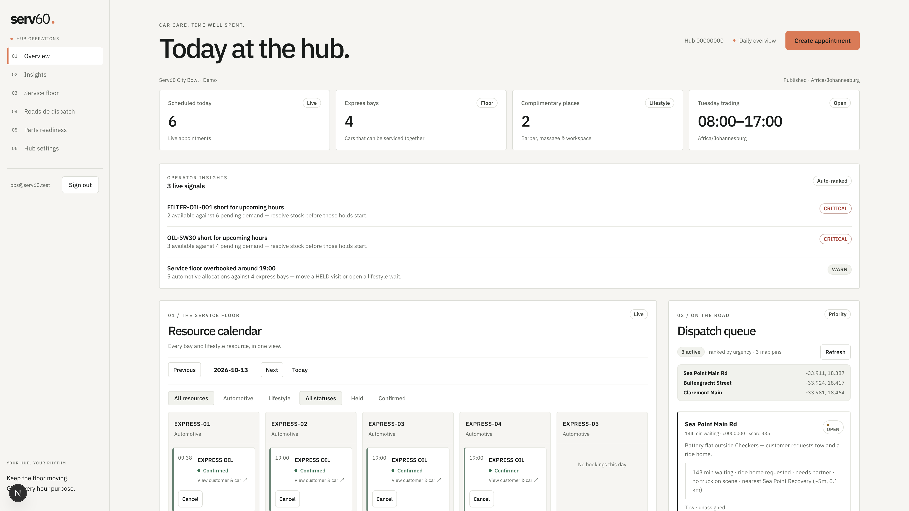

# Serv60 platform

Serv60 is a one-hour express vehicle service with complimentary lifestyle time at the hub — barber, massage, or private workspace — plus roadside recovery when customers need help on the road.

This workspace is the runnable pilot: a Spring Boot API, a Flutter customer app, and a Next.js hub operations console.

<p align="center">
  
</p>

<p align="center"><em>Hub operations — floor calendar, operator insights, roadside dispatch, and parts readiness.</em></p>

<p align="center">
  
</p>

<p align="center"><em>Customer app — find a hub, plan a visit, manage bookings and roadside.</em></p>

## What it does

### Customer app (Flutter)

- **Sign in with Clerk** (Google) — name and email stay read-only from Clerk
- **Explore hubs** near you (or the Cape Town demo)
- **Plan a visit** — pick a day/slot, optional complimentary service, and which vehicle (up to five on the account)
- **Bookings** — pay held visits (Yoco), change or cancel when policy allows
- **Visit help** — plain-language change assistance (secondary to Plan visit)
- **Roadside** — request recovery and track partners
- **Account** — phone and vehicle garage

### Hub operations (Next.js)

- **Staff sign-in** — demo email session locally; Auth0 Universal Login ready for production ([`operations-web/AUTH0_LOGIN.md`](operations-web/AUTH0_LOGIN.md))
- **Today at the hub** — scheduled counts, bay capacity, trading hours
- **Operator insights** — parts shortages, floor pressure, held-soon alerts; ranked roadside priority with “why this truck”
- **Service floor calendar** — express bays in order, then repair/extras, then lifestyle; held vs confirmed; flip a card for customer & car
- **Roadside dispatch** — urgency-ranked queue and assignment
- **Parts readiness** — stock vs pending demand
- **Hub settings** — express/lifestyle capacity and seven-day trading hours

### Backend (Java / Spring Boot)

Modular monolith with booking, service planning, inventory, payments, roadside marketplace, and a bounded concierge/assistant API. PostgreSQL + Flyway migrations, idempotent holds, transactional outbox.

## Demo

[`DEMO.md`](DEMO.md) runs the whole stack on one laptop with a floor simulation on, so a visit can be followed in the app while the console's **Live floor** board moves in real time.

## Workspace layout

| Path | Role |
|------|------|
| `backend/` | API — booking, payments, roadside, concierge, hub settings |
| `operations-web/` | Staff console |
| `mobile/` | Customer Flutter app |
| `infra/` | Docker Compose (Postgres, LocalStack, optional full stack) + seed scripts |
| `contracts/openapi.yaml` | Shared HTTP contract (core booking/ops surfaces) |

## Quick start

### Full local stack

```sh
cd platform/infra
docker compose up -d --build postgres backend
# optional ops UI container, or run Next locally (below)
```

API: `http://localhost:8080` · health: `/actuator/health`

Seed demo insights / dispatch data:

```sh
./seed-ops-insights.sh
```

### Operations UI

```sh
cd operations-web
npm install
NEXT_PUBLIC_API_BASE_URL=http://localhost:8080 npm run dev
```

Open `http://localhost:3000`, enter any staff email on `/login`.

### Mobile

```sh
cd mobile
flutter pub get
flutter run \
  --dart-define=SERV60_DEMO_MODE=true \
  --dart-define=SERV60_API_BASE_URL=http://127.0.0.1:8080 \
  --dart-define=SERV60_CLERK_FRONTEND_API=https://YOUR.clerk.accounts.dev \
  --dart-define=SERV60_CLERK_OAUTH_CLIENT_ID=YOUR_CLIENT_ID \
  --dart-define=SERV60_CLERK_REDIRECT_URL=serv60://oauth/callback/ \
  --dart-define=SERV60_CLERK_LOGOUT_REDIRECT_URL=serv60://oauth/logout/
```

- Android emulator API host: `http://10.0.2.2:8080`
- Physical device: use your machine’s LAN IP
- Profile builds launch cleanly from the iOS home screen: `flutter run --profile …`

Clerk setup: [`CLERK_SETUP.md`](CLERK_SETUP.md). Deep links: [`mobile/DEEP_LINK_SETUP.md`](mobile/DEEP_LINK_SETUP.md).

### Backend only (Maven)

```sh
docker compose -f infra/docker-compose.yml up -d postgres
cd backend && mvn spring-boot:run
```

Requires Maven 3.9+ (no `mvnw` in-repo yet).

## Auth model

| Surface | Identity |
|---------|----------|
| Customer mobile | **Clerk** (OIDC / Google) |
| Hub operators | Demo email session → **Auth0** for production |
| API | JWT resource server when `SECURITY_ENABLED=true`; local defaults keep security off |

Older Cognito notes remain in [`COGNITO_GOOGLE_SETUP.md`](COGNITO_GOOGLE_SETUP.md) for reference. Payments: [`PAYMENTS.md`](PAYMENTS.md).

## Product rules worth knowing

- Every customer booking is **express oil for one hour**; at most one complimentary option rides along (`BARBER` / `MASSAGE` / `PRIVATE_WORK`)
- Holds are idempotent; confirmation, cancel, and expiry apply to the whole visit
- Operator insights are **deterministic** (ranking + alerts) so the floor stays useful without a language model
- Customer journey / assistant ops notes: [customer journey runbook](../docs/customer-journey-runbook.md)

## Tests

```sh
# Backend (example)
cd backend && mvn -Dtest=OpsInsightsServiceTest test

# Operations UI
cd operations-web && npm test

# Mobile
cd mobile && flutter test --coverage --concurrency=1
```

## Screenshots

Assets live in [`docs/images/`](docs/images/):

- `ops-dashboard.png` — hub operations overview
- `mobile-home.png` — customer Explore tab
