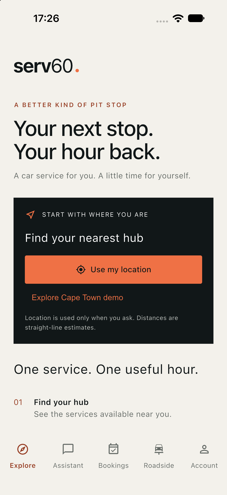

# Serv60 customer app

Flutter app for Serv60 customers: find a hub, plan a one-hour express visit (optional complimentary lifestyle time), manage bookings and vehicles, and request roadside recovery.

<p align="center">
  
</p>

## Tabs

| Tab | Purpose |
|-----|---------|
| **Explore** | Nearby / demo hubs and open Plan visit |
| **Bookings** | Held and confirmed appointments — pay, change, cancel |
| **Roadside** | Request and track recovery |
| **Account** | Clerk profile (read-only name/email), phone, vehicle garage (up to 5) |

Visit help (change assistance) lives under Bookings / Plan visit as a secondary path — not a primary tab.

## Run

From this directory:

```sh
flutter pub get
flutter run \
  --dart-define=SERV60_DEMO_MODE=true \
  --dart-define=SERV60_API_BASE_URL=http://127.0.0.1:8080 \
  --dart-define=SERV60_CLERK_FRONTEND_API=https://YOUR.clerk.accounts.dev \
  --dart-define=SERV60_CLERK_OAUTH_CLIENT_ID=YOUR_CLIENT_ID \
  --dart-define=SERV60_CLERK_REDIRECT_URL=serv60://oauth/callback/ \
  --dart-define=SERV60_CLERK_LOGOUT_REDIRECT_URL=serv60://oauth/logout/
```

- **Android emulator:** use `http://10.0.2.2:8080` for the API
- **Physical device:** use your machine’s LAN IP
- **Profile** (clean launch from iOS home screen): `flutter run --profile` with the same defines

Clerk and OAuth: [`../CLERK_SETUP.md`](../CLERK_SETUP.md). Deep links: [`DEEP_LINK_SETUP.md`](DEEP_LINK_SETUP.md).

Platform overview (ops UI + backend): [`../README.md`](../README.md).

## Tests

```sh
flutter test --coverage --concurrency=1
```
